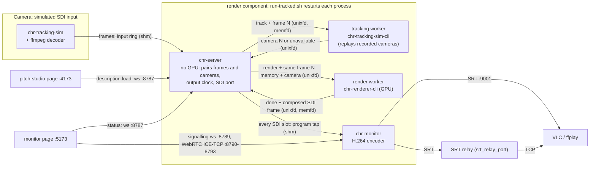

# chr

## Project Structure

| Directory | Purpose | Language |
| --- | --- | --- |
| `client/src/` | Client-side code | Primarily TypeScript |
| `client/pitch-studio/` | Onsite pitch client: Three.js pitch preview and read-only Fusion match data | TypeScript (Vite) |
| `client/example/` | Example clients and verification harnesses, such as `render-harness/` | TypeScript |
| `server/` | Live render server: renderer library in `renderer/` (`chr-renderer`), render server runtime in `runtime/` (`chr-runtime`, building `chr-server`, its render worker `chr-renderer-cli`, its tracking worker stand-in `chr-tracking-sim-cli` and the `chr-tracking-sim` camera simulator), native window/headless shell in `viewer/` (`chr-app`) | Primarily Rust |
| `monitor/` | `chr-monitor`: optional video monitor process that encodes the `chr-server` program tap for WebRTC/SRT viewers | Rust |
| `Cargo.toml`, `Cargo.lock`, `rust-toolchain.toml` | Root Rust workspace for the crates under `server/`, `monitor/` and `common/` | Rust |
| `common/` | Shared communication protocols: `chr-common` JSON-RPC 2.0 messages and NativeSocket/WebSocket IPC | Rust (TypeScript mirrors in clients) |
| `common/shm/` | `chr-shm`: shared-memory frame rings between processes (capture input ring, program tap) | Rust |
| `flake.nix`, `flake.lock` | Shared, pinned Linux development environment and renderer build/check entry points | Nix |
| `docs/` | Repository-wide documentation, including `docs/development.md`; server contracts live in `server/docs/` | |
| `external/vchao/` | Git submodule of [Hong-Xiang/vchao](https://github.com/Hong-Xiang/vchao) (soccer video VPP), pinned; never edited here | Python |
| `reference/` | All reference materials (private, local-only, ignored by Git) | |
| `output/<module>/` | Generated runtime artifacts, including renderer images in `output/renderer/` (local-only, ignored by Git) | |

## Runtime processes

The local stack (`uv run server/scripts/stack.py start`, see `server/README.md`)
runs these processes and connections:



The same in text, with every channel:

```text
              camera (simulated SDI input)
  ┌───────────────────────────────────────────┐
  │ chr-tracking-sim  ◄── ffmpeg decodes clip │
  └─────┬─────────────────────────────────────┘
  frames│ input ring (shm)
        ▼
  ┌───────────────────────────────────────────────────────────┐ ws :8787 control
  │ chr-server (no GPU)                                       │◄── description.load, status ── pitch-studio :4173
  │ pairs frames and cameras, output clock, scene state,      │    (through its /chr-render proxy)
  │ supervises both workers, simulated SDI port (UYVY)        │◄── status ───────────────────── monitor page :5173
  └───┬─────▲───────────────────┬─────▲─────────────────┬─────┘
      │     │ ①                 │     │ ②               │ ③ program tap (shm)
      ▼     │                   ▼     │                 ▼
  ┌─────────┴────────────┐  ┌─────────┴────────┐  ┌───────────────────────────────────────┐
  │ tracking worker      │  │ render worker    │  │ chr-monitor (H.264: x264 or openh264) │── SRT udp :9001 ──► VLC / ffplay
  │ chr-tracking-sim-cli │  │ chr-renderer-cli │  └───────────────────┬───────────────────┘   └► stack.py relay tcp ──► players over SSH
  │ (replay stand-in)    │  │ (GPU)            │                      ├─ ws :8789 status, WebRTC signalling ──► monitor page
  └──────────────────────┘  └──────────────────┘                      └─ WebRTC ICE-TCP :8790-8793, per viewer ─► monitor page

  ① `track` carrying frame N as memfd memory ▼; its camera (Ti, C, frame_warp) or `unavailable` ▲
  ② `render` carrying the same frame N memory and its camera ▼; `done` carrying the composed SDI frame ▲
  ①② two GStreamer unixfd sockets per worker; each message is JSON in a buffer's GstCustomMeta
  ③ every slot the SDI port sends
```

Each box is one process; `shm` is a `chr-shm` shared-memory ring (the capture
input and the program tap). chr-server starts, feeds and replaces both workers and
talks to each over two GStreamer `unixfdsink`/`unixfdsrc` sockets: every message
is JSON in a buffer's `GstCustomMeta`, and frames are memfd memory passed as file
descriptors, so chr-server copies each captured frame once and both workers read
that copy. Clients such as pitch-studio still talk JSON-RPC to chr-server over
WebSocket or the NativeSocket, unchanged. `chr-tracking-sim-cli` replays the
clip's recorded cameras and estimates nothing. The real tracking module (for
example vchao's adapter, #140) replaces it by speaking the same protocol
(`chr-server --tracking-cli`); see
[tracking worker](server/docs/tracking-worker.md). With `tracking = "external"` in
`stack.toml`, no tracking worker runs and the simulator sends each camera as
`tracking.frame` on `<dir>/render.sock`. `run-tracked.sh` restarts the simulator,
chr-server and chr-monitor independently, so one exiting does not stop the others.
Viewers only ever see what the SDI port sent. Ports are the defaults of
`server/scripts/stack.example.toml`; `stack.py start` and `status` print the ports
each running process actually holds.

## Operating the onsite stack

From the main checkout, outside a Nix shell, after copying
`server/scripts/stack.example.toml` to `output/stack/stack.toml`:

```sh
uv run server/scripts/stack.py start                      # build, start, wait until frames flow
uv run server/scripts/stack.py status                     # health, URLs and the ssh -L forwards
uv run server/scripts/stack.py restart pitch-studio       # one component; the output keeps running
uv run server/scripts/stack.py stop
```

Runtime data lives outside the repository, under chr-server's asset root
(`asset_root`): Fusion offline ZIPs, logo, flag and model files, and the studio
store (`studio_data_dir`), which holds matches, onsite placements and uploads.
The [operations guide](docs/operations.md) covers configuration, launching,
remote access, the studio workflow, every file location and troubleshooting.

## Design Documentation

See [product and system design](docs/README.md) for the evolving business
workflow, proposed module boundaries, and open decisions. These documents are
discussion drafts, not implemented interfaces or a frozen protocol.

## Development

Create a dedicated branch and Git worktree under `.worktree/` before implementing a new feature. Make feature changes and run validation in that worktree, not in the primary working tree.

From the repository root:

```powershell
git worktree add -b feature/my-feature .worktree/my-feature main
```

Clone with its submodules:

```sh
git clone --recursive https://github.com/xiaoyxue/chr.git
```

In an existing clone or a new worktree, run `git submodule update --init` instead.
The vchao submodule needs read access to that private repository; builds and
checks do not need it.

See `AGENTS.md` for contributor guidelines and `docs/development.md` for the
directory layout, toolchain ownership, and complete development workflow.

Run Cargo commands from the repository root. See `server/README.md` for setup and usage, and `server/AGENTS.md` for server-specific guidelines.

## Linux development and builds

The single root `flake.nix` and `flake.lock` provide Node.js/npm, TypeScript
(`tsc`), the Rust toolchain, renderer libraries and GStreamer (core, base and the
bad plugins' `unixfd` elements, which carry chr-server's worker messages) in one
development shell.
They also retain the renderer package and checks. Tool versions come from the
existing locked inputs; the Cargo workspace and Rust toolchain file are at the
repository root. No client framework or algorithm stack is selected.

For the video-only FFmpeg-to-GStreamer software input helper, optional
`chr-server --software-video` simulation and the `chr-monitor` SRT/GStreamer
encoder (`--features gstreamer-media`), use `nix develop .#media`; see
`server/README.md`, which also shows how to run `chr-server` and `chr-monitor`
together with `server/scripts/run-live.sh`. This optional shell adds FFmpeg, the
ugly plugins and Python GObject bindings without changing the default environment
or providing SDI hardware.

From the repository root:

```sh
nix develop
node --version
npm --version
tsc --version
cargo run --locked -p chr-app -- --headless
```

In a separate shell, from the repository root:

```sh
nix build
nix flake check
nix run . -- --headless
nix run .#pitch-studio
```

The default package and `packages.<system>.chr-app` build the renderer;
the default app runs it. Checks include Node.js/npm/TypeScript tool availability,
Rust formatting, Clippy, and CPU tests, plus the `pitch-studio` client
typecheck and build. `nix run .#pitch-studio` serves that client; see
`docs/development.md` for its Fusion settings. `client/src/` is currently a
placeholder; the example harness in `client/example/render-harness/` has its own
npm scripts.
`nix fmt` formats Nix files. GPU runs need a working hardware driver; see
`server/README.md` for non-NixOS host-driver wrappers.

The Nix shell uses an absolute `target/linux` Cargo cache, unchanged by
switching directories. Root `result` / `result-*` links, `target/`, and
`output/` are ignored. Renderer PNGs go to root `output/renderer/triangle.png`
from any directory in the checkout. Outside a checkout, the packaged app writes to
`output/renderer/triangle.png` under its working directory. Build sources include
only the root Cargo manifests and the filtered Rust sources and shaders under
`server/`, `monitor/` and `common/`, excluding private references, worktrees,
caches, and generated outputs. `node_modules/` and TypeScript incremental caches
are also ignored. Never stage private files.
