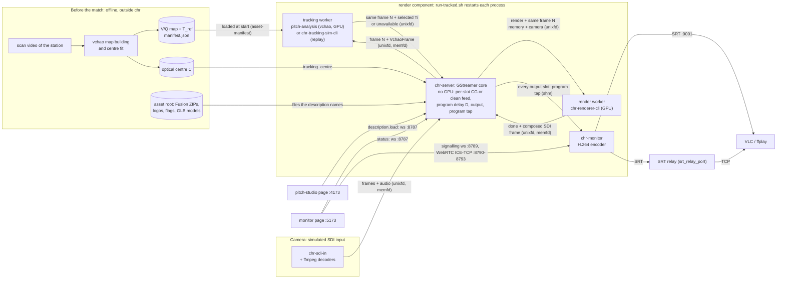

# chr

## Project Structure

| Directory | Purpose | Language |
| --- | --- | --- |
| `client/src/` | Client-side code | Primarily TypeScript |
| `client/pitch-studio/` | Onsite pitch client: Three.js pitch preview and read-only Fusion match data | TypeScript (Vite) |
| `client/example/` | Example clients and verification harnesses, such as `render-harness/` | TypeScript |
| `server/` | Live render server: renderer library in `renderer/` (`chr-renderer`), tracking logic in `tracker/` (`chr-tracker`: the tracking worker contract, pose-to-camera mapping, lens selection, frame/camera join and the replay stand-in's logic), render server runtime in `runtime/` (`chr-runtime`, building `chr-server`, its render worker `chr-renderer-cli`, its tracking worker stand-in `chr-tracking-sim-cli` and `chr-sdi-in`, the capture input of its GStreamer core), native window/headless shell in `viewer/` (`chr-app`) | Primarily Rust |
| `monitor/` | `chr-monitor`: optional video monitor process that encodes the `chr-server` program tap for WebRTC/SRT viewers | Rust |
| `Cargo.toml`, `Cargo.lock`, `rust-toolchain.toml` | Root Rust workspace for the crates under `server/`, `monitor/` and `common/` | Rust |
| `common/` | Shared communication protocols: `chr-common` JSON-RPC 2.0 messages and NativeSocket/WebSocket IPC | Rust (TypeScript mirrors in clients) |
| `common/shm/` | `chr-shm`: the shared-memory program tap that chr-server writes and chr-monitor reads | Rust |
| `flake.nix`, `flake.lock` | Shared, pinned Linux development environment and renderer build/check entry points | Nix |
| `docs/` | Repository-wide documentation, including `docs/development.md`; server contracts live in `server/docs/` | |
| `external/vchao/` | Git submodule of [Hong-Xiang/vchao](https://github.com/Hong-Xiang/vchao) (soccer video VPP), pinned; never edited here | Python |
| `asset/` | Git submodule of the private `xiaoyxue/chr-assets` (Git LFS): large binary assets, today `asset/ibl/` environment maps; not needed to build | EXR |
| `reference/` | All reference materials (private, local-only, ignored by Git) | |
| `output/<module>/` | Generated runtime artifacts, including renderer images in `output/renderer/` (local-only, ignored by Git) | |

## Runtime processes

The local stack (`uv run server/scripts/stack.py start`, see `server/README.md`)
runs these processes and connections:



The same in text, with every channel:

```text
              camera (simulated SDI input; a DeckLink card with --source decklink)
  ┌──────────────────────────────────────────────────────────┐
  │ chr-sdi-in  ◄── ffmpeg decodes the clip at its own rate  │
  └─────┬────────────────────────────────────────────────────┘
  frames│ + audio: unixfd sockets <dir>/capture.sock(.audio), memfd
        ▼
  ┌───────────────────────────────────────────────────────────┐ ws :8787 control
  │ chr-server (no GPU): one GStreamer pipeline               │◄── description.load, status ── pitch-studio :4173
  │ every frame leaves D after capture: its CG, else its own  │    (through its /chr-render proxy)
  │ clean feed; supervises both workers; output (UYVY) on the │◄── status ───────────────────── monitor page :5173
  │ pipeline clock (simulated sink, or a DeckLink card)       │◄── optical centre C (--tracking-centre); files under the asset root
  └───┬─────▲───────────────────┬─────▲─────────────────┬─────┘
      │     │ ①                 │     │ ②               │ ③ program tap (shm)
      ▼     │                   ▼     │                 ▼
  ┌─────────┴────────────┐  ┌─────────┴────────┐  ┌───────────────────────────────────────┐
  │ tracking worker      │  │ render worker    │  │ chr-monitor (≤1080p H.264: NVENC/x264)│── SRT udp :9001 ──► VLC / ffplay
  │ pitch-analysis       │  │ chr-renderer-cli │  └───────────────────┬───────────────────┘   └► stack.py relay tcp ──► players over SSH
  │ (vchao, GPU), or     │  │ (GPU)            │                      ├─ ws :8789 status, WebRTC signalling ──► monitor page
  │ chr-tracking-sim-cli │  │                  │                      └─ WebRTC ICE-TCP :8790-8793, per viewer ─► monitor page
  │ (replay stand-in)    │  │                  │
  └──────────▲───────────┘  └──────────────────┘
             │ ④
  scan video ─► vchao map building (offline, before the match) ─► V/Q map + T_ref (manifest.json), optical centre C

  ① frame N as memfd memory with vchao's VchaoFrame meta ▼; the same frame N with its selected Ti or `unavailable` ▲
  ② `render` carrying the same frame N memory and its camera ▼; `done` carrying the composed SDI frame ▲
  ①② two GStreamer unixfd sockets per worker; each message is JSON in a buffer's GstCustomMeta
  ③ every slot the output sends
  ④ pitch-analysis loads the station's V/Q map at start (--asset-manifest); the replay stand-in reads the clip's manifest instead
```

Each box is one process; the only shared-memory ring left is the program tap
(`chr-shm`), which chr-monitor reads. Frames travel as memfd memory over GStreamer
`unixfdsink`/`unixfdsrc` sockets end to end: chr-sdi-in writes each captured
frame once and chr-server, both workers and the delay queue map that same memory.
chr-server runs one GStreamer pipeline ([GStreamer core](server/docs/gst-core.md)):
every frame's slot is due its capture time plus the program delay D
(`--program-delay-ms`, `program_delay_ms` in `stack.toml`) and goes out with its CG
if that arrived in time, else with its own clean feed. Every worker message is
JSON in a buffer's `GstCustomMeta`. The tracking hop speaks vchao's VchaoFrame
contract: each frame goes to the tracking worker and comes back with its `Ti`.
Clients such as pitch-studio still talk JSON-RPC to chr-server over WebSocket or
the NativeSocket, unchanged. `chr-tracking-sim-cli` replays the clip's recorded
`Ti` and estimates nothing. vchao's `pitch-analysis` replaces it unchanged
(`chr-server --tracking-cli`, #148); see [tracking worker](server/docs/tracking-worker.md).
`pitch-analysis` loads a V/Q map built offline for the station
(`--asset-manifest`), and chr-server gets that station's optical centre C
(`--tracking-centre`, `tracking_centre` in `stack.toml`); see
[vchao atlas, V, Ti and T_ref](docs/vchao-atlas.md).
With `tracking = "external"` in `stack.toml`, no tracking worker runs and
`chr-sdi-in --send-cameras` sends each frame's recorded camera as `tracking.frame`
on `<dir>/render.sock`. `run-tracked.sh` restarts chr-sdi-in, chr-server and
chr-monitor independently, so one exiting does not stop the others. Viewers only
ever see what the output sent. Ports are the defaults of
`server/scripts/stack.example.toml`; `stack.py start` and `status` print the ports
each running process actually holds, and `status` the core's D, CG ratio, per-slot
slack and render budget.

## Operating the onsite stack

From the main checkout, outside a Nix shell, after copying
`server/scripts/stack.example.toml` to `output/stack/stack.toml`:

```sh
uv run server/scripts/stack.py start                      # build, start, wait until frames flow
uv run server/scripts/stack.py status                     # health, URLs and the ssh -L forwards
uv run server/scripts/stack.py restart pitch-studio       # one component; the output keeps running
uv run server/scripts/stack.py stop
```

Runtime data lives outside the repository, under chr-server's asset root
(`asset_root`): Fusion offline ZIPs, logo, flag and model files, and the studio
store (`studio_data_dir`), which holds matches, onsite placements and uploads.
The [operations guide](docs/operations.md) covers configuration, launching,
remote access, the studio workflow, every file location and troubleshooting.

## Status and next steps

Working today:
- **Live stack:** onsite cameras from 1080p (the onsite target) up to DCI 4K 4096x2160 (#144).
  - At 1080p30 every frame carries CG with the onsite description and the tracking worker.
  - 4K is accepted but not yet sustained at 30 fps with the software camera simulation.
  - The monitor preview is at most 1080p and encoded with NVENC.
- **Worker transport:** chr-server and its render and tracking workers exchange frames and messages over GStreamer `unixfdsink`/`unixfdsrc` (#141). Each captured frame is copied once and shared by both workers.
- **Camera model from the lens that arrives (#150):** each tracked frame is rendered with the tracking worker's lens, else a `--tracking-lens-*` lens, else pinhole; vchao's `pitch-analysis` sends none (pinhole), the replay stand-in sends its manifest's lens (radial, without per-frame warps). `stack.py status` shows the model and its source ([lens](server/docs/tracking-worker.md#lens)).
- **GStreamer core (#154):** every tracked program runs on one GStreamer pipeline in chr-server from `chr-sdi-in`'s memfd frames to the output: a fixed capture-to-output delay, each slot's own clean feed when its CG is late, workers relinked into the running pipeline after a crash, and the input's rate and format from its caps, followed at runtime (or converted to a fixed output rate) with a new tracking stream ([GStreamer core](server/docs/gst-core.md)). Rates are exact fractions everywhere (`--fps 30000/1001` or `29.97`). Interlaced input (1080i50, 1080i59.94) keeps its fields on the output and is deinterlaced for tracking and rendering only; a lost input is filled with the last frame, black or a slate on the cadence; the input's audio, timecode and captions leave with their frame's delay. DeckLink input and output (`--source decklink`, `--output decklink` at a fixed output rate, the card's clock as the pipeline's) are built and tested without a card but not verified on hardware. The timer-paced tracked path, the shared-memory capture ring and `chr-sdi-sim` are gone (phase 5): `chr-sdi-in` is the one capture process, `--program-delay-ms` the one delay, and `sdi.get_status.core` and `stack.py status` report D, slot counts, the CG ratio, per-slot slack and the render budget (#131). Generated programs (triangle, `--synthetic-program`, `--pitch-demo`, `--software-video`) keep an internal clock.
- **Tracking crate (#151):** chr's tracking logic (VchaoFrame contract, pose-to-camera mapping, lens selection, frame/camera join, replay stand-in) is the pure-logic crate `chr-tracker` beside `chr-renderer`; `chr-runtime` keeps the worker processes and their GStreamer transport.
- **Pitch studio:**
  - waving flags;
  - a server-side studio store;
  - export/import of onsite placements;
  - sends that reuse one control connection.

Next, in order:

| Issue | Work | State |
| --- | --- | --- |
| #146 | Enable Resizable BAR on render hosts: a second Vulkan process on the same GPU is about 1000x slower while it is off | `necessary`, host configuration; do before #148 phase 2 testing, then add to the [host checklist](docs/operations.md#host-checklist) |
| #148 | vchao's `pitch-analysis` (`atlas-vq-estimate`) replaces the `chr-tracking-sim-cli` replay as the tracking worker over vchao's VchaoFrame unixfd contract (supersedes #140's transport) | Done (closed): chr speaks VchaoFrame, frames without camera are clean feed, `pitch-analysis` (pin `f209fc9`) tracks the SC1464 fixture through chr-server ([measured](server/docs/tracking-worker.md#measured)); CG from vchao's `Ti` verified on an exclusive GPU; integration with an onsite station's map is the open follow-up |
| #154 | chr-server owns one GStreamer pipeline: card-clocked I/O, memfd frames, per-slot clean feed, rate lock, input-driven rate | Done in simulation (phases 1 to 5); DeckLink input/output, genlock, RP 188 and embedded audio on a card are not verified on hardware (with #80) |
| #80 | Physical SDI capture and output | Not started; the DeckLink code paths of #154 wait for a card |

## Design Documentation

See [product and system design](docs/README.md) for the evolving business
workflow, proposed module boundaries, and open decisions. These documents are
discussion drafts, not implemented interfaces or a frozen protocol.

## Development

Create a dedicated branch and Git worktree under `.worktree/` before implementing a new feature. Make feature changes and run validation in that worktree, not in the primary working tree.

From the repository root:

```powershell
git worktree add -b feature/my-feature .worktree/my-feature main
```

Clone with its submodules:

```sh
git clone --recursive https://github.com/xiaoyxue/chr.git
```

In an existing clone or a new worktree, run `git submodule update --init` instead.
The vchao submodule needs read access to that private repository; builds and
checks do not need it.

See `AGENTS.md` for contributor guidelines and `docs/development.md` for the
directory layout, toolchain ownership, and complete development workflow.

Run Cargo commands from the repository root. See `server/README.md` for setup and usage, and `server/AGENTS.md` for server-specific guidelines.

## Linux development and builds

The single root `flake.nix` and `flake.lock` provide Node.js/npm, TypeScript
(`tsc`), the Rust toolchain, renderer libraries and GStreamer (core, base, the
bad plugins' `unixfd` elements, which carry chr-server's worker messages, and
gst-plugins-rs' `livesync` and `fallbackswitch` and gst-plugins-good's
`deinterlace` for the GStreamer core) in one
development shell.
They also retain the renderer package and checks. Tool versions come from the
existing locked inputs; the Cargo workspace and Rust toolchain file are at the
repository root. No client framework or algorithm stack is selected.

For the video-only FFmpeg-to-GStreamer software input helper, optional
`chr-server --software-video` simulation and the `chr-monitor` SRT/GStreamer
encoder (`--features gstreamer-media`), use `nix develop .#media`; see
`server/README.md`, which also shows how to run `chr-server` and `chr-monitor`
together with `server/scripts/run-live.sh`. This optional shell adds FFmpeg, the
ugly plugins and Python GObject bindings without changing the default environment
or providing SDI hardware.

From the repository root:

```sh
nix develop
node --version
npm --version
tsc --version
cargo run --locked -p chr-app -- --headless
```

In a separate shell, from the repository root:

```sh
nix build
nix flake check
nix run . -- --headless
nix run .#pitch-studio
```

The default package and `packages.<system>.chr-app` build the renderer;
the default app runs it. Checks include Node.js/npm/TypeScript tool availability,
Rust formatting, Clippy, and CPU tests, plus the `pitch-studio` client
typecheck and build. `nix run .#pitch-studio` serves that client; see
`docs/development.md` for its Fusion settings. `client/src/` is currently a
placeholder; the example harness in `client/example/render-harness/` has its own
npm scripts.
`nix fmt` formats Nix files. GPU runs need a working hardware driver; see
`server/README.md` for non-NixOS host-driver wrappers.

The Nix shell uses an absolute `target/linux` Cargo cache, unchanged by
switching directories. Root `result` / `result-*` links, `target/`, and
`output/` are ignored. Renderer PNGs go to root `output/renderer/triangle.png`
from any directory in the checkout. Outside a checkout, the packaged app writes to
`output/renderer/triangle.png` under its working directory. Build sources include
only the root Cargo manifests and the filtered Rust sources and shaders under
`server/`, `monitor/` and `common/`, excluding private references, worktrees,
caches, and generated outputs. `node_modules/` and TypeScript incremental caches
are also ignored. Never stage private files.
