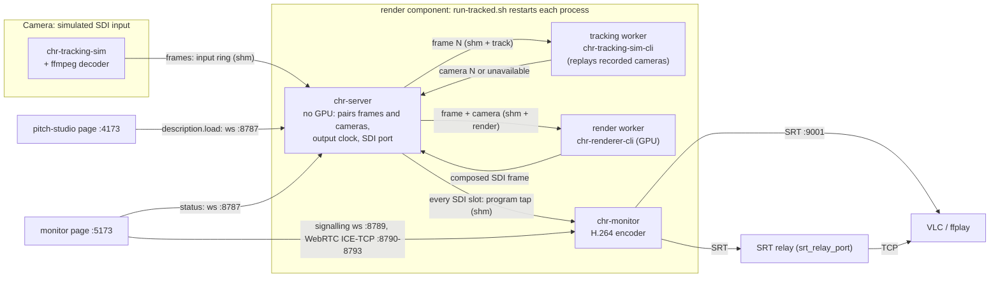

# Development environment and repository layout

## Directory ownership

The root flake is the single Linux development entry point for the TypeScript
client and Rust server. Both the flake and the Cargo workspace live at the
repository root; do not initialize a second flake or a second Cargo workspace.
Module boundaries:

```text
flake.nix                 Shared development tools, renderer builds, and checks
flake.lock                Pinned Nix inputs for the whole repository
AGENTS.md                 Repository-wide contributor rules
CLAUDE.md                 Imports AGENTS.md for Claude Code (also server/CLAUDE.md)
README.md                 Project overview and quick start
client/src/               TypeScript client sources (currently a placeholder)
client/pitch-studio/      Onsite pitch client (Vite + Three.js), built by the flake
client/example/           Example clients and harnesses, each its own npm package
Cargo.toml                Rust workspace definition (members under server/, monitor/, common/)
Cargo.lock                Locked Rust dependencies
rust-toolchain.toml       Rust toolchain selection
server/                   Live render server; see server/AGENTS.md
server/renderer/          chr-renderer: coordinate math, GPU setup, and rendering
server/runtime/           chr-runtime: chr-server (render server), its workers chr-renderer-cli (also
                          stills) and chr-tracking-sim-cli (replay stand-in for the tracking module),
                          and chr-tracking-sim (simulated camera, optionally with its cameras)
  src/input/              Video acquisition adapters (software MP4, shared-memory input ring)
  src/calibration/        Calibration consumption and frame/lens association
  src/program/            Demo scenes and admitted-frame rendering bridge
  src/sdi.rs              Simulated SDI output port, output clock and program tap
  src/worker/             Render worker protocol, the worker side and its supervisor
  src/worker/tracking/    Tracking worker protocol and its supervisor
server/viewer/            chr-app: native window and headless delivery shell
server/docs/              Server-specific contracts
server/scripts/           Server-specific development helpers
monitor/                  chr-monitor: program-tap encoding and WebRTC/SRT fan-out
common/                   chr-common: JSON-RPC 2.0 messages and local IPC (Rust)
common/shm/               chr-shm: shared-memory frame rings; the only crate with unsafe
docs/                     Repository-wide documentation
reference/                Private, local-only reference materials
output/<module>/          Generated runtime artifacts, including output/renderer/
.worktree/                Dedicated feature worktrees
```

Keep module sources inside their owning module, not at the repository root.
Use `docs/` for cross-module development and architecture documents, and
`server/docs/` for server-specific contracts. Do not move private reference
materials into documentation, source files, fixtures, or Nix build inputs.
The shared protocol is implemented in Rust (`common/`), with TypeScript
mirrors in clients. No client framework is chosen by this environment setup.

Live tracking runs in a tracking worker that `chr-server` supervises
(`server/runtime/src/worker/tracking/`, [tracking worker](../server/docs/tracking-worker.md)). Its
protocol is language-neutral, so the real tracking module, which may be written in
Python, replaces the `chr-tracking-sim-cli` replay stand-in without changing the
server. Pairing frames with cameras belongs in the runtime, not the renderer:
`calibration/tracking` joins them by capture sequence. The `calibration/replay`
module is only a startup-loaded lens replay for a validated clip. Offline scene
modelling (scan video to calibration results) stays outside this repository.
A general public distortion contract and physical SDI adapters are not
implemented by this layout.

`chr-server` creates no GPU device. As decided in #94 and implemented in #97, it
starts and supervises a `chr-renderer-cli worker` process that renders every
frame, and transmits clean feed while that worker is late, failed or being
replaced. #95 moved video monitoring
into the separate `chr-monitor` process: `chr-server` writes every transmitted
SDI slot into a shared-memory program tap that `chr-monitor` encodes for viewers.
`monitor/` is a root crate, not a server crate, because it is an optional process
that may run on another host from an SDI loop-out.

## Start a feature

From the primary checkout, create a dedicated branch and worktree:

```sh
git fetch origin
git worktree add -b feature/my-feature .worktree/my-feature origin/main
cd .worktree/my-feature
nix develop
```

Make feature changes and run validation inside that worktree. Never discard
unrelated work or develop the feature in the primary checkout.

## Shared Linux tools

The root development shell provides:

| Area | Tools |
| --- | --- |
| TypeScript client | Node.js, its bundled npm, and TypeScript (`tsc`) |
| Rust server | Rust/Cargo, rustfmt, and Clippy from `rust-toolchain.toml` via the locked Rust overlay |
| Build and maintenance | Git, pkg-config, and nixfmt |
| Renderer runtime | Vulkan loader, OpenGL, X11, Wayland, and keyboard/window libraries |

The optional `nix develop .#media` shell inherits these tools and adds FFmpeg,
GStreamer core/base/bad/ugly plugins, and Python GObject bindings. It runs the video-only
software input helper under `server/scripts/` and builds the opt-in
`gstreamer-media` feature of `chr-runtime` and `chr-monitor`; it does not install
SDI drivers, provide a physical SDI device, or change the renderer protocol. The
bad plugins provide H.264 parsing, MPEG-TS muxing and the direct SRT output of
`chr-monitor`.

Use Nix for Linux development dependencies, not global npm tool installation.
Node.js and TypeScript come from the existing pinned nixpkgs input. Keep
`flake.lock` and `Cargo.lock` tracked, and do not upgrade their revisions
incidentally when changing documentation, directories, or shell packages.

From the repository root:

```sh
nix develop
node --version
npm --version
tsc --version
rustc --version
cargo --version
```

`client/src/` is currently a placeholder with no package or build scripts; do not
run bare `tsc` there or invent `npm run` scripts as repository validation. Example
packages under `client/example/` are self-contained: run `npm install` and their
documented scripts inside each package (see
`client/example/render-harness/README.md`). Keep client configuration within
`client/`.

`client/pitch-studio/` is a self-contained npm package. For development, run
`npm ci` and `npm run dev` (127.0.0.1:5186), `npm run build` or
`npm run test:offline` inside it. Without Fusion, a match can be imported from an
offline Fusion ZIP (`manifest.json` plus `assets/`) in the browser. Every import
(match ZIP, videos, PLY, result folder, ad materials) can be picked locally or
loaded by an absolute path on the onsite server; surrounding whitespace and quotes
(as pasted by "Copy as path") are dropped. The root flake builds it from
`package-lock.json` (see the next section). Its 发送到渲染器 action (on the 广告位预览
and 导入结果与微调 tabs) converts the
placement draft into a render description and loads it into `chr-server` through
the page's `/chr-render` WebSocket proxy (`CHR_RENDER_URL`); see
`server/docs/render-description.md`.

Placement editing in the top view uses pitch-centred world coordinates (+X right,
+Y down), drawn as axes with metre ticks, the pitch length and width and its corner
coordinates. A selected placement shows its vertices and opens locked; it must be
unlocked (button or `L`) before it can be dragged, resized from its corners or
edited numerically: 2D areas by their top-left corner or centre, with an aspect
ratio that can be locked or set (`16:9`, `1.78`), 3D models by centre and one
uniform scale. Outlines are the placement slots; a selected 3D model also shows
its real XY bounding box.
Rotation is read-only. Each target can be enabled or disabled, and every draft
change can be undone with the 撤销 button or `Ctrl/Cmd+Z` until the match is
reloaded.

`uv run server/scripts/stack.py start|stop|restart|status` starts and stops the
whole local development stack (tracked simulation, pitch-studio client, program
monitor page, optional SRT relay) from a local `output/stack/stack.toml`; see
`server/README.md`. It builds both pages and serves them with `vite preview`, so a
dropped SSH tunnel does not reload them; restart the stack after client changes.
Use `npm run dev` for hot reload while developing a client.

The stack's processes and how they connect:



The same in text, with every channel:

```text
              camera (simulated SDI input)
  ┌───────────────────────────────────────────┐
  │ chr-tracking-sim  ◄── ffmpeg decodes clip │
  └─────┬─────────────────────────────────────┘
  frames│ input ring (shm)
        ▼
  ┌───────────────────────────────────────────────────────────┐ ws :8787 control
  │ chr-server (no GPU)                                       │◄── description.load, status ── pitch-studio :4173
  │ pairs frames and cameras, output clock, scene state,      │    (through its /chr-render proxy)
  │ supervises both workers, simulated SDI port (UYVY)        │◄── status ───────────────────── monitor page :5173
  └───┬─────▲───────────────────┬─────▲─────────────────┬─────┘
      │     │ ①                 │     │ ②               │ ③ program tap (shm)
      ▼     │                   ▼     │                 ▼
  ┌─────────┴────────────┐  ┌─────────┴────────┐  ┌───────────────────────────────────────┐
  │ tracking worker      │  │ render worker    │  │ chr-monitor (H.264: x264 or openh264) │── SRT udp :9001 ──► VLC / ffplay
  │ chr-tracking-sim-cli │  │ chr-renderer-cli │  └───────────────────┬───────────────────┘   └► stack.py relay tcp ──► players over SSH
  │ (replay stand-in)    │  │ (GPU)            │                      ├─ ws :8789 status, WebRTC signalling ──► monitor page
  └──────────────────────┘  └──────────────────┘                      └─ WebRTC ICE-TCP :8790-8793, per viewer ─► monitor page

  ① frame N in a shm ring and a `track` line ▼; its camera (Ti, C, frame_warp) or `unavailable` ▲
  ② frame N with its camera, in a shm ring and a `render` line ▼; the composed SDI frame ▲
  ③ every slot the SDI port sends
```

Each box is one process; `shm` is a `chr-shm` shared-memory ring. chr-server
starts, feeds and replaces both workers; their requests and replies are JSON lines
on stdin/stdout. `chr-tracking-sim-cli` replays the clip's recorded cameras and
estimates nothing. The real tracking module replaces it by speaking the same
protocol (`chr-server --tracking-cli`); see
[tracking worker](../server/docs/tracking-worker.md). With `tracking = "external"` in
`stack.toml`, no tracking worker runs and the simulator sends each camera as
`tracking.frame` on `<dir>/render.sock`. `run-tracked.sh` restarts the simulator,
chr-server and chr-monitor independently, so one exiting does not stop the others.
Viewers only ever see what the SDI port sent. Ports are the defaults of
`server/scripts/stack.example.toml`; `stack.py start` and `status` print the ports
each running process actually holds.

Run Cargo commands from the repository root after entering the root shell.
Windows native setup is documented in `server/README.md`; this flake defines Linux outputs for x86_64 and aarch64.
Validate on the actual target rather than assuming an output declaration proves
that platform works.

## Builds and checks

Run these commands from the repository root:

```sh
nix flake check --no-update-lock-file
nix build --no-update-lock-file
nix fmt -- --check flake.nix
```

The default package and named `chr-app` package build the renderer viewer,
`chr-server` builds the headless render server and `chr-renderer-cli`, and `chr-monitor` builds the
video monitor process. `pitch-studio` builds the onsite client: the static
site in `share/pitch-studio/dist` and a `pitch-studio` launcher. The
default application runs the viewer; `nix run .#pitch-studio` serves the
client.
`nix flake check` includes:

| Check | Coverage |
| --- | --- |
| `client-toolchain` | Node.js, npm, and TypeScript version commands execute in a Nix build sandbox |
| `pitch-studio` | `client/pitch-studio` typecheck, production build and offline-package tests (`npm run test:offline`) from the locked npm dependencies |
| `media-source` | Python tests in `server/scripts/`: synthetic MP4 decoding into a GStreamer appsink, pixel integrity, fractional-rate loop timing and short-input failure; `stack.py` configuration, components and process records |
| `fmt` | Rust workspace formatting |
| `clippy` | Rust workspace and all targets, with warnings treated as errors |
| `tests` | Rust workspace CPU tests; hardware GPU tests remain explicitly ignored |

The toolchain smoke check is not a client typecheck or application test. The
`pitch-studio` check typechecks and builds that client and runs its Node
tests, but does not run it in a browser.

The client launcher runs `vite preview` on the built site, including the
read-only Fusion proxy under `/fusion-api/`. Run it from a directory holding the
onsite `.env.local` (see `client/pitch-studio/.env.example`), or set the
variables in its environment; process variables take precedence:

```sh
FUSION_API_URL=https://localhost:50001 FUSION_API_KEY=... \
  nix run .#pitch-studio -- --port 4173
```

It listens on 127.0.0.1 (port 4173 by default). Without both variables the proxy
answers 503. The key is read at runtime only; never put it in `VITE_*` variables
or the Nix store. For a local HTTPS Fusion server, set `NODE_EXTRA_CA_CERTS` to
its certificate first.

Server paths are read by the same process under `/local-files/`, only for
requests to a loopback host (use an SSH port forward from another machine), and
only inside `LOCAL_FILES_ROOTS` (`:`-separated; the home directory by default),
never hidden files or symlinks that leave those folders.

The studio keeps all of its data on the onsite server, not in the browser, in
one directory: `STUDIO_DATA_DIR` (`output/pitch-studio` in the repository for
`npm run dev` / `vite preview`, or under the working directory for the
`pitch-studio` launcher; the stack's `studio_data_dir`). The same process serves
it under `/studio-store/`, for loopback hosts only: `matches.json` (the match
library and Fusion drafts), `package-paths.json` (offline ZIP paths),
`matches/<matchId>/local-ads.json` and `session.json` (placements made onsite and
the operator's session, kept apart from the Fusion package),
`matches/<matchId>/exports/` (exported onsite placements), and
`files/<sha256>.<ext>` (uploaded materials up to 64 MB and offline ZIPs up to 1
GB). Each document carries a revision; a write based on an older one is refused
with 409, so two pages cannot overwrite each other. Keep the directory inside
chr-server's `--asset-root` so the uploaded files can be sent to the renderer.
To run Rust checks directly, enter `nix develop` at the root, then:

```sh
cargo fmt --all -- --check
cargo clippy --locked --workspace --all-targets -- -D warnings
cargo test --locked --workspace
```

GPU acceptance is separate from build success. From the root, run the packaged
application with `nix run . -- --headless`; non-NixOS systems may need the
host-driver wrapper documented in `server/README.md`. Select real hardware,
inspect the logged adapter, and use the documented GPU pixel test for rendering
changes. SSH supports headless validation, not interactive window acceptance.
Do not treat software rendering or a successful compilation as hardware proof.

## Generated files and private inputs

The root Nix shell sets `CARGO_TARGET_DIR` to the absolute path
`<worktree>/target/linux`. Changing directories does not create a second Cargo
cache. Plain Cargo outside the shell uses `target/` by default; keep platform
build artifacts separate.

Root `result` / `result-*` symlinks are Nix build outputs. Runtime artifacts
belong under root `output/<module>/`. Renderer PNGs go to
`output/renderer/triangle.png` when launched from anywhere in the checkout;
outside a checkout the packaged app uses that path relative to its working
directory.
Keep client runtime artifacts in `output/client/` or `output/<harness>/`, such as
`output/render-harness/`. These outputs,
`node_modules/`, and TypeScript `.tsbuildinfo` caches are ignored by Git.

The Rust Nix build source includes only the root Cargo manifests and the
filtered Rust sources and WGSL shaders under `server/`, `monitor/` and `common/`, excluding
private references, worktrees, caches, and generated outputs. Client sources and
their dependencies are not part of the Rust packages.

Git-backed flakes see tracked files only. Stage explicit project paths before
validating new files; never stage `reference/`, private assets, credentials,
runtime outputs, or dependency caches. Keep this document, root `README.md`,
and `AGENTS.md` synchronized when changing layout or development commands.
