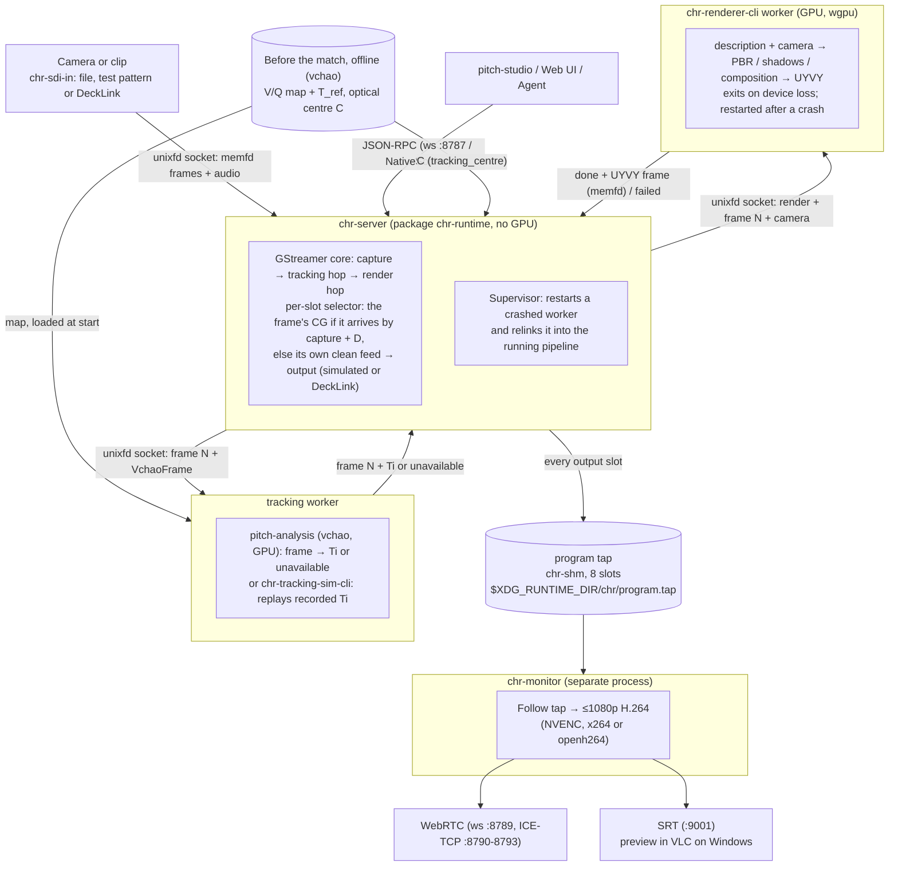
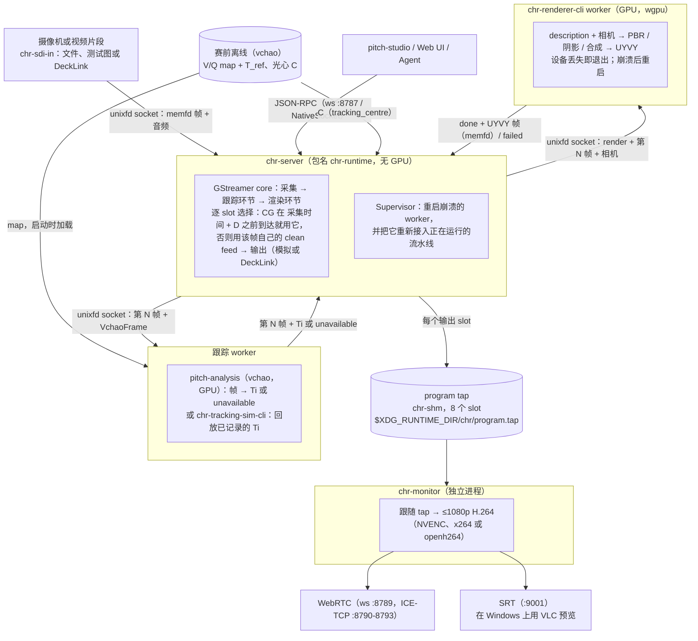

# Live process overview / 实时进程总览

**Status:** `implemented` on Linux (#100, #141, #154). Details: [architecture](live-process-architecture.md),
[implementation plan](live-process-implementation.md), [GStreamer core](../server/docs/gst-core.md).

- [English](#english)
- [中文](#中文)

## English

The live service runs on Linux as five processes: `chr-sdi-in` captures,
`chr-server` runs the program on one GStreamer pipeline and supervises a tracking
worker and a render worker, and `chr-monitor` streams what the output sent.
Windows PCs only preview its SRT output (for example in VLC).

Key points:

- **Fixed delay, per-slot clean feed:** every frame leaves its capture time
  plus the program delay D (`--program-delay-ms`) later, with its own CG if that
  arrived in time, else with its own clean feed (the input without CG). A frame
  never borrows another frame's camera.
- **Fault isolation:** the GPU is used only in the workers. If a worker crashes,
  hangs or loses its device, program output continues as clean feed; the worker
  is restarted and relinked into the running pipeline, and CG returns.
- **Monitoring is decoupled:** `chr-monitor` only reads the program tap and never
  feeds back. Encoding and streaming cannot stall program output, and the monitor
  restarts on its own.
- **Transport:** `chr-sdi-in` and both workers talk to `chr-server` over
  GStreamer `unixfdsink`/`unixfdsrc` sockets. Each message is JSON in a buffer's
  custom meta; frames are memfd memory passed as file descriptors, so a captured
  frame is written once and shared by `chr-server`, both workers and the delay
  queue.
- **Shared memory (`chr-shm`):** only the program tap, a single-writer,
  many-reader ring; torn reads are discarded.
- **Tracking:** vchao's `pitch-analysis` estimates each frame's `Ti` against a
  V/Q map built offline for the station; chr-server gets the station's optical
  centre C from `--tracking-centre`. `chr-tracking-sim-cli` replays a clip's
  recorded `Ti` and estimates nothing. See
  [tracking worker](../server/docs/tracking-worker.md) and
  [vchao atlas, V, Ti and T_ref](vchao-atlas.md).
- **Code layout:** `server/renderer` (`chr-renderer`, the library),
  `server/tracker` (`chr-tracker`, tracking logic), `server/runtime`
  (`chr-server`, `chr-renderer-cli`, `chr-tracking-sim-cli`, `chr-sdi-in`),
  `monitor/` (`chr-monitor`), `common/` (protocol, IPC and `chr-shm`),
  `server/viewer` (local window and PNG export).
- **Generated programs** (triangle, `--synthetic-program`, `--pitch-demo`,
  `--software-video`) have no input and keep an internal clock.
- **Offline rendering:** `chr-renderer-cli render` renders one frame, identical
  to the worker's output.

Not done yet: physical SDI capture and output, with the DeckLink code paths,
genlock and embedded audio verified on a card (#80, #161); vchao tracking with
a map of an onsite station (#148); a hot-standby worker.

## 中文

直播服务在 Linux 上以五个进程运行：`chr-sdi-in` 负责采集；`chr-server` 在一条 GStreamer 流水线上运行节目，
并监管一个跟踪 worker 和一个渲染 worker；`chr-monitor` 推流输出端实际发出的画面。
Windows 电脑只用来预览它的 SRT 输出（例如用 VLC）。

要点：

- **固定延迟，逐 slot 的 clean feed：** 每一帧在采集时间加节目延迟 D（`--program-delay-ms`）时发出：
  它的 CG 及时到达就带 CG，否则发它自己的 clean feed（不带 CG 的原始画面）。一帧绝不借用别的帧的相机。
- **故障隔离：** 只有 worker 使用 GPU。worker 崩溃、卡住或丢失设备时，节目输出以 clean feed 继续；
  worker 重启并重新接入正在运行的流水线后，CG 自动恢复。
- **监看解耦：** `chr-monitor` 只读 program tap，从不回写。编码和推流不会拖慢节目输出，
  monitor 也可以单独重启。
- **传输：** `chr-sdi-in` 和两个 worker 都通过 GStreamer `unixfdsink`/`unixfdsrc` socket 与
  `chr-server` 通信。每条消息是 buffer 自定义 meta 里的 JSON；帧是以文件描述符传递的 memfd 内存，
  所以一帧采集画面只写一次，由 `chr-server`、两个 worker 和延迟队列共用。
- **共享内存（`chr-shm`）：** 只剩 program tap，一个单写多读的环形缓冲，读到被覆盖了一半的帧直接丢弃。
- **跟踪：** vchao 的 `pitch-analysis` 依据为该机位离线建好的 V/Q map 估计每一帧的 `Ti`；
  `chr-server` 通过 `--tracking-centre` 得到该机位的光心 C。`chr-tracking-sim-cli` 回放片段已记录的
  `Ti`，不做任何估计。见 [tracking worker](../server/docs/tracking-worker.md) 和
  [vchao 的 atlas、V、Ti 与 T_ref](vchao-atlas.zh-CN.md)。
- **代码分层：** `server/renderer`（`chr-renderer`，渲染库）、`server/tracker`（`chr-tracker`，跟踪逻辑）、
  `server/runtime`（`chr-server`、`chr-renderer-cli`、`chr-tracking-sim-cli`、`chr-sdi-in`）、
  `monitor/`（`chr-monitor`）、`common/`（协议、IPC 和 `chr-shm`）、`server/viewer`（本地窗口和 PNG 导出）。
- **生成类节目**（三角形、`--synthetic-program`、`--pitch-demo`、`--software-video`）没有输入，
  使用内部时钟。
- **离线渲染：** `chr-renderer-cli render` 单独渲染一帧，结果与 worker 渲染的一致。

尚未完成：物理 SDI 采集和输出，包括在真实板卡上验证 DeckLink 代码路径、genlock 和嵌入音频（#80、#161）；
使用现场机位 map 的 vchao 跟踪（#148）；热备 worker。
