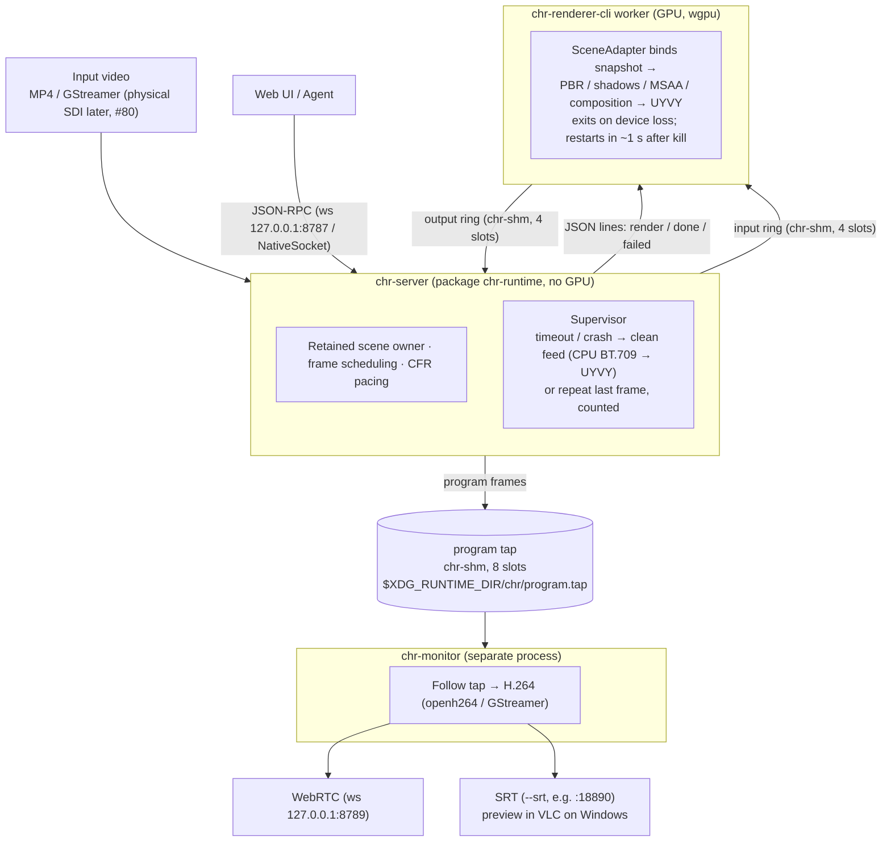
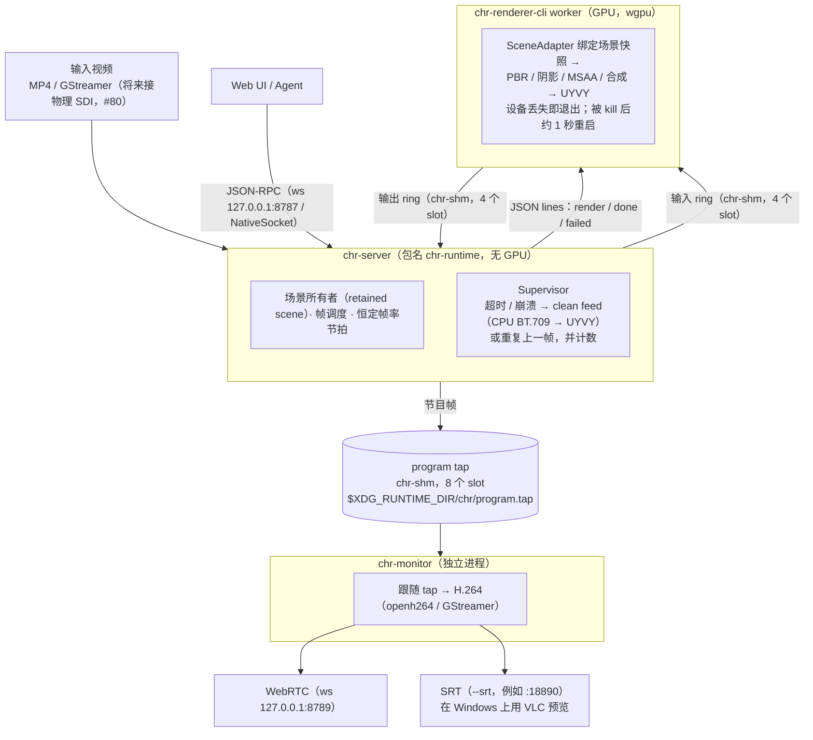

# Live process overview / 实时进程总览

**Status:** `implemented` on Linux (#100). Details: [architecture](live-process-architecture.md),
[implementation plan](live-process-implementation.md).

- [English](#english)
- [中文](#中文)

## English

The live service runs on Linux as three processes. Windows PCs only preview its
SRT output (for example in VLC).

Key points:

- **Fault isolation:** the GPU is used only in the worker. If the worker crashes,
  hangs or loses its device, program output continues. A frame the worker misses
  by its deadline (3/4 of a frame by default) goes out as clean feed (the input
  without CG); CG returns when the worker restarts.
- **Monitoring is decoupled:** `chr-monitor` only reads the program tap and never
  feeds back. Encoding and streaming cannot stall program output, and the monitor
  restarts on its own.
- **Shared memory (`chr-shm`):** single-writer, many-reader rings on mapped
  files; torn reads are discarded. A 1080p RGBA frame costs about 1.3 ms to
  write and 1.1 ms to read.
- **Code layout:** `server/renderer` (`chr-renderer`, the library),
  `server/runtime` (`chr-server` and `chr-renderer-cli`), `monitor/`
  (`chr-monitor`), `common/` (protocol and IPC), `server/viewer` (local window
  and PNG export).
- **Offline rendering:** `chr-renderer-cli render` renders one frame, identical
  to the worker's output.

Not done yet: physical SDI input/output, genlock and fixed delay (#80), hardware
H.264 encoding (#3) and a hot-standby worker.

## 中文

直播服务在 Linux 上以三个进程运行；Windows 电脑只用来预览它的 SRT 输出（例如用 VLC）。

要点：

- **故障隔离：** 只有 worker 使用 GPU。worker 崩溃、卡住或丢失设备时，节目输出不中断：
  worker 没在截止时间（默认帧周期的 3/4）内交付的帧改发 clean feed（不带 CG 的原始画面），
  worker 重启后自动接回 CG。
- **监看解耦：** `chr-monitor` 只读 program tap，从不回写。编码和推流不会拖慢节目输出，
  monitor 也可以单独重启。
- **共享内存（`chr-shm`）：** 基于映射文件的单写多读环形缓冲，读到被覆盖了一半的帧直接丢弃。
  1080p RGBA 一帧写约 1.3 ms、读约 1.1 ms。
- **代码分层：** `server/renderer`（`chr-renderer`，渲染库）、`server/runtime`
  （`chr-server` 和 `chr-renderer-cli`）、`monitor/`（`chr-monitor`）、`common/`
  （协议和 IPC）、`server/viewer`（本地窗口和 PNG 导出）。
- **离线渲染：** `chr-renderer-cli render` 单独渲染一帧，结果与 worker 渲染的一致。

尚未完成：物理 SDI 输入/输出、genlock 与固定延迟（#80），硬件 H.264 编码（#3），以及热备 worker。
