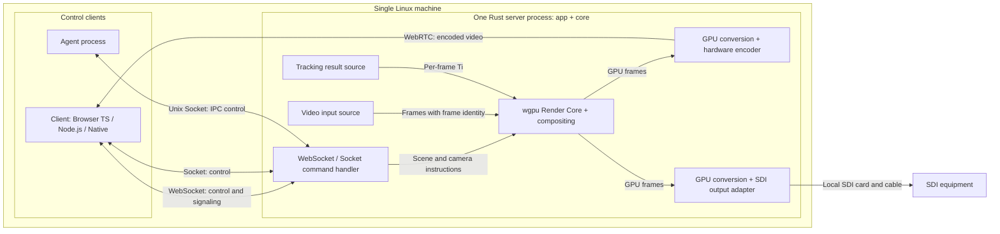

# Render Server and Client Design

Status: proposed design, not yet implemented. No SDI signal source or output
card is available yet, so Phase 1 uses simulated input, tracking, and SDI
output (section 6).

All software components run on the same Linux machine.
An installed SDI output card can send video to external SDI equipment. This
design does not include Windows support, cross-machine software connections,
or remote deployment.

Chinese version: `render-server-client-design.zh-CN.md`.
Keep both versions synchronized when updating this design.

## 1. Control and Output Channels

**WebSocket and Socket for control; one GPU render feeds WebRTC and SDI outputs.**

| Channel | Purpose | Endpoint |
| --- | --- | --- |
| WebSocket | Send instructions, receive results/status, and exchange WebRTC signaling. | Browser or Node.js TypeScript client. |
| Socket | Send the same instructions and receive the same results/status. | Node.js client or native tool. |
| Agent IPC (Socket) | Send instructions and receive results/status through the same command protocol. | Agent process. |
| WebRTC | Deliver encoded rendering output as a live video stream. | Browser TypeScript client. |
| SDI | Deliver uncompressed video through a local output card. | External SDI equipment. |

Socket means Unix Domain Socket (UDS). The Agent uses this same Socket backend;
it does not require a separate protocol or privileged command path.
Browsers use WebSocket because they cannot directly access these Socket
endpoints. The choice is based on client runtime, not machine location.

## 2. Overview

The input source, tracking result source, and SDI output adapter are
replaceable boundaries. Phase 1 uses simulated implementations; Phase 2
replaces them with hardware and the tracking service (section 6).

WebSocket and Socket are alternative entrances to the **same command handler**.
The Agent connects over Socket and shares the same validation, authorization,
command queue, and authoritative scene state as the UI. Do not maintain a
separate Agent-owned renderer or bypass normal command handling.
WebRTC and SDI are independent output paths, not instruction transports.
The client node groups alternative runtimes, not a requirement to use all
channels at once. Browsers use WebSocket and WebRTC; Node.js/native clients
can use Socket for control. Browser playback and SDI output consume the same
rendered scene, without routing SDI through the browser or WebRTC.

## 3. Responsibilities

| Component | Responsibility |
| --- | --- |
| `client/src/` | Send instructions and display WebRTC video; provide a local Socket adapter for Node.js clients. |
| `render/crates/app/` | Host the renderer and server in one process. Handle UI/Agent commands, the input and tracking sources, and the independent WebRTC/SDI output modules. |
| `render/crates/core/` | A library managing scene/camera state and rendering GPU frames with wgpu. No networking, capture-card, or output-card dependencies. |
| `common/src/` | Define the shared command, response, and event protocol for Rust and TypeScript. |

The Agent is a separate control process using the shared protocol. Its runtime
and code location are not prescribed by this design.

These are the target directories. Cargo package names remain `chr-app` and
`chr-core`. **The wgpu renderer and server run in the same process**, not in
separate services. The client remains separate. This avoids cross-process GPU
texture sharing between the server and renderer.

Same process does not mean same thread: use a render worker and asynchronous
network tasks with bounded command queues. Do not block network I/O on GPU work.
Keep the two output modules in `app`; no extra services or transport framework
are required.

## 4. Basic Flow

1. The UI connects through WebSocket or Socket; the Agent connects through
   Unix Domain Socket on the same Linux machine.
2. The browser also exchanges WebRTC signaling over WebSocket to establish video.
3. The UI or Agent sends an instruction, such as changing the camera. The server
   validates it, applies it through the core, and returns a result.
4. The core renders a GPU frame once. The server independently feeds it to
   hardware encoding/WebRTC for browser playback and to the SDI output adapter.

In the live runtime, frames are driven by the video input: the core renders
the overlay with the matching tracking result and composites it onto the
input frame before both outputs (section 6).

A control-only client does not need WebRTC. A command response confirms
the operation's result, not that the resulting frame has already been displayed.
The Agent does not need a video connection to control rendering. Requests from
the UI and Agent must be correlated to their originating connections, and scene
mutations must pass through the same serialized command execution path.

## 5. GPU Frames and Two Outputs

The goal is to avoid raw-pixel CPU readback, not to eliminate all CPU activity.
CPU code still handles commands, resource management, scheduling, and signaling.

| Output | Intended data path | CPU involvement |
| --- | --- | --- |
| WebRTC | GPU texture -> GPU color conversion -> hardware encoder -> WebRTC -> browser hardware decode/display. | Compressed bitstreams and protocol processing normally pass through CPU/system memory. |
| SDI | GPU texture -> required GPU format conversion -> supported direct DMA path -> SDI card. | Scheduling and synchronization; a host-memory-free pixel path depends on the exact hardware and SDK. |

For WebRTC, start by validating H.264 hardware encoding, such as NVENC.
NVENC uses a dedicated hardware encoder rather than rendering shaders.
Single-frame encoding can be millisecond-scale, but this is not a measured
result for this project and does not describe total display latency.

Use low-latency encoder settings, avoid B-frame reordering and lookahead, and
bound queues. Validate texture interoperability and browser hardware decoding
on the target Linux system. GPU-only format conversions or copies are acceptable;
do not label the complete path zero-copy without evidence.

For SDI, validate the specific card, GPU, driver, SDK, OS, and PCIe topology.
Capture-to-GPU support does not prove GPU-to-SDI output support. A GPUDirect label
alone does not prove that pixels avoid host memory. Report an unsupported direct
path rather than silently falling back to CPU readback.

The outputs must not block one another. Keep separate bounded queues; discard
stale WebRTC frames before encoding when needed. Schedule SDI at the selected
video mode's hardware cadence with an explicit underrun policy. If SDI is the
program output, prioritize its timing over browser preview.

Use a bounded GPU frame pool and GPU completion signals. Do not reuse a texture
until its consumers have finished; prevent a slow output from retaining frames
indefinitely. Each output may require different pixel formats and resolutions.

## 6. Phased Delivery and Replaceable Boundaries

No SDI signal source or output card is available yet. Phase 1 therefore runs
the complete pipeline with simulated boundaries. Phase 2 replaces them with
hardware after it is selected and validated. Both phases use the same command
semantics, frame pipeline, and output scheduling, so hardware integration
replaces implementations instead of restructuring the pipeline. This follows
the simulation and replay requirement in #1.

The live runtime confirmed in #1 is input-driven: capture -> tracking ->
render/composite -> outputs. Model each boundary as a replaceable interface
from the start, rather than building an output-only path first.

| Boundary | Phase 1 (simulated) | Phase 2 (hardware) |
| --- | --- | --- |
| Video input | Decoded local video file or generated test pattern; each frame carries a frame identity and timecode. | SDI capture card (Cam1). |
| Tracking result | Recorded or synthetic per-frame Ti, matched by frame identity. | Real-time tracking service. |
| Render and composite | Real implementation: render the overlay and composite it onto the input frame. | Unchanged. |
| Browser preview | Real implementation: GPU hardware encoding -> WebRTC. | Unchanged. |
| SDI output | Simulated sink: fixed-cadence output in the SDI pixel format, written to a file or frame dump. | SDI output card. |
| Clock | Controllable clock that can pause, step, and accelerate. | Hardware reference clock or input-locked timing. |

Frame identity comes from the input source and travels with each frame through
tracking, composition, and both outputs. Do not substitute buffer slots or
output frame counters for it. The behavior when a frame has no matching
tracking result is still open in #1; make it explicit rather than silently
reusing a stale result.

The simulated SDI sink simulates the output constraints, not only image delivery:

- Emit frames at the selected video mode's cadence, driven by the controllable
  clock.
- Use a bounded queue, count underruns, and apply the documented underrun
  policy, such as repeating the last frame.
- Convert to the intended SDI pixel format on the GPU, such as 10-bit YUV
  4:2:2, so the conversion can be reused with real hardware.
- It may read pixels back to the CPU to write files. Label this path as
  simulation-only; it does not relax the no-raw-readback rule for WebRTC or
  for the hardware SDI path.

Phase 1 does not cover selecting the SDI card or SDK, validating a direct
GPU-to-SDI-card path, hardware genlock, or any SDI latency claims. These belong
to Phase 2. Once a card that supports both input and output is available,
looping its output back to its own input allows self-testing without an
external signal source.

## 7. Latency and Validation

For same-machine hardware-encoded WebRTC, use approximately **50-150 ms from a
completed GPU frame to browser display** as an initial planning budget, not a
benchmark, guarantee, or fixed WebRTC delay. Measure encoding, queuing, receive
buffering, decoding, and presentation separately, plus end-to-end P50/P95.
Command-to-display latency also includes command handling and render scheduling.

Every additional buffered frame adds about 16.7 ms at 60 FPS or 33.3 ms at
30 FPS. Fast encoding alone cannot compensate for a growing queue.
Browser playback and SDI are not automatically synchronized.

Start with one rendering session, a TS client, and an Agent Socket connection.
In Phase 1, use the simulated input, tracking, and SDI sink from section 6.
Verify that UI and Agent commands affect the same scene and that responses go
to the correct caller. Prove camera control and browser playback at 720p/30 FPS,
then evaluate low-latency 1080p60 where supported.
In Phase 2, select the SDI format according to the actual output card and
downstream equipment. These are validation targets, not performance guarantees.

## 8. First-Version Rules

- Use the same JSON command/response definitions and request IDs for both
  WebSocket and Socket, including the Agent connection. Share command handling,
  not platform-specific handles.
- One WebSocket message carries one protocol message. Local byte streams use a
  4-byte big-endian payload length followed by the JSON bytes.
- Limit message sizes and queue lengths. Coalesce obsolete camera updates
  without silently dropping important commands.
- Keep instructions on WebSocket/Socket, browser video on WebRTC, and SDI on its
  independent output path. Do not introduce a DataChannel command path or stream
  PNGs as the main video transport.
- Bind the WebSocket listener to loopback addresses only, not all interfaces.
  Validate browser origins and session identity; restrict Socket access using
  Linux directory/socket permissions and peer credentials where needed. Apply
  the same authorization rules to Agent and UI commands.
- WebRTC still needs signaling and ICE negotiation for same-machine video.
  Do not configure external STUN/TURN services for the first version; validate
  local connectivity in the target browsers.
- Validate the GPU-to-encoder path on Linux. The existing blocking
  CPU readback helper remains useful for screenshots/tests, not the intended
  continuous streaming path.
