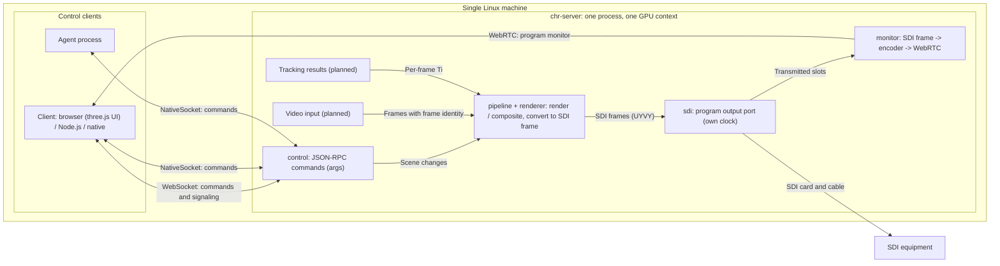

# Render Server and Client Design

Status: Phase 1 slice implemented in #10, on the repository layout from #9: local
IPC, the render pipeline, a simulated SDI output, and its WebRTC monitor. Video
input, tracking, compositing, and all hardware paths are not implemented yet
(section 7).

All server software runs on the same Linux machine. An installed SDI output card
sends the program video to external SDI equipment. This design does not include
Windows support, cross-machine control connections, or remote deployment. For
development, a browser elsewhere may reach the loopback endpoints through an SSH
port forward (section 9).

Chinese version: `render-server-client-design.zh-CN.md`.
Keep both versions synchronized when updating this design.

## 1. Control and Output Channels

**The renderer produces exactly one output: the SDI program frame. Clients watch
that program output, encoded and streamed back over WebRTC.**

| Channel | Purpose | Endpoint |
| --- | --- | --- |
| WebSocket | Send commands (args), receive results/status, and exchange WebRTC signaling. | Browser or Node.js TypeScript client. |
| NativeSocket | Send the same commands and receive the same results/status. | Node.js client or native tool. |
| Agent IPC (NativeSocket) | Send commands and receive results/status through the same protocol. | Agent process. |
| SDI | The program output: uncompressed video through a local output card. | External SDI equipment. |
| WebRTC | A monitor of the SDI program output, encoded as H.264. | Browser client. |

NativeSocket means a Unix Domain Socket (UDS). The Agent uses this same backend;
it does not require a separate protocol or privileged command path. Browsers use
WebSocket because they cannot open Unix sockets. The choice is based on client
runtime, not machine location.

## 2. Overview



WebSocket and NativeSocket are alternative entrances to the **same command
handler**. The Agent shares the same validation, authorization, command queue,
and authoritative scene state as the UI. Do not maintain a separate
Agent-owned renderer or bypass normal command handling.

The program output is the single source of video. The monitor encodes exactly
what the SDI port transmitted, repeats included, so a client sees the program as
it went out. Do not add a second, render-direct client stream. WebRTC and SDI
carry video only; neither transports commands.

The video input and tracking boundaries are replaceable. Phase 1 will simulate
them; Phase 2 replaces them with capture hardware and the tracking service
(section 7).

## 3. Code Layout and Server Roles

| Path | Crate | Responsibility |
| --- | --- | --- |
| `common/` | `chr-common` | Shared protocol: JSON-RPC 2.0 messages, business methods, and the NativeSocket/WebSocket IPC transports. Rust is the source of truth; TypeScript clients mirror its types. |
| `server/renderer/` | `chr-renderer` | GPU rendering and GPU format conversion to the SDI pixel format. No networking, capture-card, or output-card dependencies. |
| `server/runtime/` | `chr-server` | The server process; modules listed below. |
| `server/viewer/` | `chr-app` | Native window and headless PNG export for renderer development. |
| `client/` | | The WebUI uses three.js for its own control and virtual-venue views; it does not reuse the Rust renderer. `client/example/render-harness/` is the example program monitor and verification harness. |

The server process has four roles. Only the last two are network services:

| Role | Module in `server/runtime/src/` |
| --- | --- |
| Pipeline host: the renderer and outputs share one process and one GPU context. | `main.rs` |
| Clock and scheduling: advance frames in logical time and hand each frame to the SDI port. | `pipeline.rs`, `scene.rs` |
| Control plane: apply commands (args) to the authoritative scene state and report the frame at which they take effect. | `control.rs` |
| Program monitor: encode the transmitted SDI output and stream it over WebRTC. | `monitor/` |

The SDI output port itself is `sdi.rs`. **The renderer and server run in the same
process**, not in separate services, which avoids cross-process GPU texture
sharing. The three.js client and the Rust renderer share no code, but they must
share the scene description and coordinate contract (pitch coordinates, Ti/SNC,
placement parameters); define those in `common/` as they are introduced.

The Agent is a separate control process using the shared protocol. Its runtime
and code location are not prescribed by this design.

Same process does not mean same thread. The render worker, the SDI output
clock, the monitor encoder, and asynchronous network tasks run separately and
exchange work through bounded queues. Network I/O never blocks on GPU work, and
no output waits for another.

## 4. Basic Flow

1. The UI connects through WebSocket or NativeSocket; the Agent connects through
   NativeSocket on the same Linux machine.
2. A browser that wants video sends a WebRTC offer over WebSocket (`webrtc.offer`)
   and receives an answer that already lists every server candidate.
3. The UI or Agent sends a command, such as `triangle.start_rotation`. The
   control plane queues it for the render worker, which applies it between
   frames and returns the resulting state, including the first frame rendered
   with it.
4. The render worker renders each frame, converts it to the SDI pixel format,
   and queues it for the SDI output port.
5. The port transmits one frame per slot at the video mode's cadence. Every
   transmitted slot is also offered to the monitor, which encodes it and sends
   it to each WebRTC peer.

In the live runtime, frames will be driven by the video input: the renderer
draws the overlay with the matching tracking result and composites it onto the
input frame before conversion (section 7).

A control-only client does not need WebRTC. A command response confirms the
operation's result, not that the resulting frame has already been displayed.
Requests from the UI and Agent are correlated to their originating connections,
and scene mutations pass through the same serialized command path; commands on
one connection execute in the order sent.

## 5. Program Output and Monitor Data Paths

The goal is to avoid raw-pixel CPU readback in the intended paths, not to
eliminate all CPU activity. CPU code still handles commands, resource
management, scheduling, and signaling.

| Path | Intended data path | Phase 1 implementation (#10) |
| --- | --- | --- |
| SDI program output | GPU frame -> GPU conversion to the SDI pixel format -> supported DMA path -> SDI card. | GPU conversion to UYVY, CPU readback, simulated port. |
| WebRTC monitor | The same GPU SDI frame -> GPU conversion to NV12 -> hardware encoder (for example NVENC) -> WebRTC -> browser decode. | Transmitted UYVY in host memory -> CPU conversion to I420 -> software H.264 (openh264). |

For the monitor, start by validating H.264 hardware encoding, such as NVENC.
Single-frame encoding can be millisecond-scale, but that is not a measured
result for this project and does not describe total display latency. Use
low-latency encoder settings, avoid B-frame reordering and lookahead, and bound
queues. Validate texture interoperability and browser hardware decoding on the
target system. GPU-only conversions or copies are acceptable; do not label the
complete path zero-copy without evidence. In production, the monitor taps the
GPU frame; it does not need to capture the SDI signal back. A separate
return-feed capture can be added later for confidence monitoring.

For SDI, validate the specific card, GPU, driver, SDK, OS, and PCIe topology
(section 6). Capture-to-GPU support does not prove GPU-to-SDI output support, and
a GPUDirect label alone does not prove that pixels avoid host memory. Report an
unsupported direct path rather than silently falling back to CPU readback.

The program output has priority. The monitor only receives slots the port could
spare: when the encoder falls behind, slots are skipped for the monitor and
counted, never delayed for the port. Use a bounded GPU frame pool and GPU
completion signals; do not reuse a texture until its consumers have finished,
and do not let a slow consumer retain frames indefinitely.

## 6. SDI Output in Detail

### 6.1 Pixel format

Phase 1 uses 8-bit UYVY 4:2:2, the packed layout DeckLink calls "8-bit YUV"
(`2vuy`). Each 4-byte group is `Cb Y0 Cr Y1` for two horizontally adjacent
pixels, so a 1280-pixel row is 2560 bytes and a 720p frame is 1.84 MB.

Colors use BT.709 coefficients in 8-bit limited range:
`Y = 16 + 219·Y'`, `Cb = 128 + 224·(B'-Y')/1.8556`, `Cr = 128 + 224·(R'-Y')/1.5748`.
Chroma is the mean of each horizontal pixel pair. A GPU test checks white,
black, red, green, and blue against the reference values byte for byte.

The renderer's sRGB-encoded values are currently used directly as video R'G'B'.
sRGB and BT.709/BT.1886 transfer functions differ slightly; the real color
pipeline (transfer function, range, 10-bit) belongs to the open color topic in #1.

### 6.2 Simulated port (`server/runtime/src/sdi.rs`)

```text
render worker: render -> GPU UYVY -> readback -> queue (capacity 3; full: drop the new frame)
SDI port thread: own monotonic clock, one slot per frame period, 2 slots of preroll
  each slot: take the next queued frame, or repeat the previous one on underrun
  -> offer the slot to the monitor (queue capacity 2; full: skip it for the monitor)
```

`sdi.get_status` reports the port's counters:

| Counter | Meaning |
| --- | --- |
| `frames_output` | Slots transmitted, including repeats. |
| `repeated_frames` | Slots that repeated the previous frame because no new frame was ready. |
| `dropped_frames` | Rendered frames discarded because the output queue was full. |
| `monitor_dropped_frames` | Slots the monitor skipped because its encoder fell behind. |
| `last_source_frame` | Render frame index of the most recent slot. |

The port keeps ticking if the monitor stops, and the monitor never delays it.

### 6.3 Timing

The render loop and the port currently run on two independent clocks at the
same nominal rate. Drift or jitter between them shows up as repeats (rendering
fell behind) or drops (rendering ran ahead); the counters exist to observe this.
Rendering to SDI output adds about 2-5 frames of latency (2 slots of preroll
plus up to 3 queued frames), 40-100 ms at 50p.

In production the SDI output clock should be the master: lock the card to the
house reference (genlock), drive rendering from the card's frame-completion
callbacks instead of a free-running timer, and keep a fixed number of frames
scheduled ahead. The two clocks then cannot drift apart.

### 6.4 Hardware mapping (DeckLink as an example, not a selection)

| Simulation | Hardware equivalent |
| --- | --- |
| Port thread and its clock | `IDeckLinkOutput::EnableVideoOutput` (for example `bmdModeHD720p50`), `ScheduleVideoFrame`, `StartScheduledPlayback` |
| Repeated and dropped counters | `ScheduledFrameCompleted` results: `DisplayedLate`, `Dropped`, `Flushed` |
| 2 slots of preroll | Frames scheduled before playback starts |
| UYVY readback into host memory | `CreateVideoFrame` with `bmdFormat8BitYUV`, or `bmdFormat10BitYUV` (v210) for 10-bit |

There are two PCIe paths for the pixels. Staging through host memory (GPU ->
host -> card) crosses PCIe twice and is DeckLink's usual model; at 720p50 that
is about 92 MB/s each way, so the cost is latency and CPU synchronization rather
than bandwidth. A GPUDirect peer-to-peer path (GPU -> card) crosses once but
depends on the card, GPU model, and driver, typically professional GPUs; confirm
support per model.

### 6.5 Not simulated yet

10-bit (v210), interlaced modes such as 1080i50, embedded audio, ancillary data
(timecode and others), reference locking, fill+key dual outputs for a downstream
keyer, SDI link identification (VPID) and 3G Level A/B, and failure bypass.
These remain open topics in #1.

## 7. Phased Delivery and Replaceable Boundaries

No SDI signal source or output card is available yet. Phase 1 runs the complete
pipeline with simulated boundaries; Phase 2 replaces them with hardware after it
is selected and validated. Both phases use the same command semantics, frame
pipeline, and output scheduling, so hardware integration replaces
implementations instead of restructuring the pipeline. This follows the
simulation and replay requirement in #1.

The live runtime confirmed in #1 is input-driven: capture -> tracking ->
render/composite -> SDI output, with the monitor tapping that output.

| Boundary | Phase 1 (simulated) | Phase 2 (hardware) | Status in #10 |
| --- | --- | --- | --- |
| Video input | Decoded local video file or generated test pattern; each frame carries a frame identity and timecode. | SDI capture card (Cam1). | Not yet. |
| Tracking result | Recorded or synthetic per-frame Ti, matched by frame identity. | Real-time tracking service. | Not yet. |
| Render and composite | Real implementation: render the overlay and composite it onto the input frame. | Unchanged. | Render only (rotating triangle). |
| SDI output | Simulated port: fixed cadence, bounded queue, repeat on underrun, counters, GPU conversion to the SDI pixel format. | SDI output card. | Done, UYVY 8-bit. |
| Monitor | Software encoding after readback. | GPU frame -> hardware encoder. | Done (software). |
| Clock | Controllable clock that can pause, step, and accelerate. | Output-locked (genlocked) timing. | Frame-based logical time; free-running monotonic pacing. |

Frame identity comes from the input source and travels with each frame through
tracking, composition, and the outputs. Do not substitute buffer slots or output
frame counters for it. The behavior when a frame has no matching tracking result
is still open in #1; make it explicit rather than silently reusing a stale
result.

Phase 1 does not cover selecting the SDI card or SDK, validating a direct
GPU-to-SDI-card path, hardware genlock, or any SDI latency claims; these belong
to Phase 2. Once a card that supports both input and output is available,
looping its output back to its own input allows self-testing without an
external signal source.

## 8. Latency and Validation

The default video mode is 1280x720p50; each buffered frame adds 20 ms. For a
same-machine hardware-encoded monitor, use approximately **50-150 ms from a
completed GPU frame to browser display** as an initial planning budget, not a
benchmark or guarantee. The SDI port's queue and preroll (section 6.3) add to
it. Measure encoding, queuing, receive buffering, decoding, and presentation
separately, plus end-to-end P50/P95. Command-to-display latency also includes
command handling and render scheduling. Browser playback and SDI are not
synchronized.

The Phase 1 slice was validated on Linux with an RTX 3090 (see #10):

- Commands from the UI (WebSocket) and an Agent-style client (NativeSocket)
  change the same scene, and responses reach the correct caller.
- The SDI port ticks at 50 slots per second; the monitor stream arrives at about
  50 fps in headless Chrome, including over ICE-TCP only.
- Decoded monitor frames change while rotating and stay still while stopped.
- Under a 10 s streaming load the port reported 0 repeated, 0 dropped, and
  0 monitor-dropped frames.
- GPU-to-host traffic measured with `nvidia-smi` was about 97 MB/s, the UYVY
  readback.

These are development measurements, not performance guarantees. In Phase 2,
select the SDI format according to the actual output card and downstream
equipment.

## 9. First-Version Rules

- Control messages use JSON-RPC 2.0 on both WebSocket and NativeSocket,
  including the Agent connection, as decided in #1. Use string request ids.
  Share command handling, not platform-specific handles.
- One WebSocket text message carries one JSON-RPC message (or batch). The
  NativeSocket uses a 4-byte big-endian payload length followed by the JSON
  bytes.
- Limit message sizes and queue lengths. A full command queue is reported as a
  busy error, not silently dropped.
- Keep commands on WebSocket/NativeSocket, the program output on SDI, and the
  monitor on WebRTC. Do not introduce a DataChannel command path or stream PNGs
  as the main video transport.
- Bind the WebSocket listener to loopback addresses only, not all interfaces.
  Validate browser origins; restrict the NativeSocket with owner-only
  directory/socket permissions and peer credentials where needed. Apply the same
  authorization rules to Agent and UI commands.
- WebRTC still needs signaling and ICE negotiation for same-machine video.
  Do not configure external STUN/TURN services. For development through an SSH
  port forward, which carries TCP only, the server can offer ICE-TCP candidates
  on a fixed loopback port range.
- Validate the GPU-to-encoder path on Linux. CPU readback remains acceptable for
  screenshots, tests, and the Phase 1 monitor, not as the intended continuous
  streaming path.
