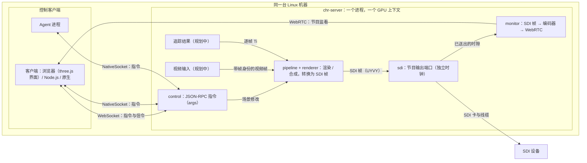

# 渲染服务端与客户端设计

状态：第一阶段的切片已在 #10 中实现（基于 #9 的仓库目录结构），包括本机 IPC、
渲染流水线、模拟 SDI 输出及其 WebRTC 监看流。视频输入、追踪、合成以及所有硬件
链路尚未实现（见第 7 节）。

所有服务端软件运行在同一台 Linux 机器上。本机安装的 SDI 输出卡把节目视频送往
外部 SDI 设备。本方案不包含 Windows 支持、跨机器的控制连接或远程部署。
开发时，其他机器上的浏览器可以通过 SSH 端口转发访问这些回环地址端点（见第 9 节）。

英文版：`render-server-client-design.md`。
更新设计时，中英文版本必须同步。

## 1. 控制与输出通道

**渲染器只产出一种输出：SDI 节目帧。客户端看到的是这路节目输出，
由服务端编码后通过 WebRTC 推回。**

| 通道 | 用途 | 端点 |
| --- | --- | --- |
| WebSocket | 发送指令（args）、接收结果与状态，同时交换 WebRTC 信令。 | 浏览器或 Node.js TypeScript 客户端。 |
| NativeSocket | 发送相同的指令，接收相同的结果与状态。 | Node.js 客户端或原生工具。 |
| Agent IPC（NativeSocket） | 通过同一协议发送指令、接收结果与状态。 | Agent 进程。 |
| SDI | 节目输出：经本机输出卡传输的未压缩视频。 | 外部 SDI 设备。 |
| WebRTC | SDI 节目输出的监看流，编码为 H.264。 | 浏览器客户端。 |

NativeSocket 指 Unix Domain Socket（UDS）。Agent 使用同一套后端，
不需要单独的协议或特权指令通道。浏览器无法打开 Unix socket，因此通过 WebSocket 接入。
选择依据是客户端运行环境，而不是机器位置。

## 2. 总览



WebSocket 和 NativeSocket 是**同一套指令处理逻辑**的不同入口。
Agent 与 UI 共用相同的校验、授权、指令队列和权威场景状态。
不为 Agent 单独维护渲染器，也不绕过正常的指令处理逻辑。

节目输出是唯一的视频来源。监看流编码的正是 SDI 端口实际送出的内容（包括重复帧），
客户端看到的就是播出的画面。不要再增加第二路由渲染直出的客户端视频流。
WebRTC 和 SDI 只传视频，都不传指令。

视频输入和追踪是可替换的边界。第一阶段会用模拟实现，
第二阶段替换为采集硬件和追踪服务（见第 7 节）。

## 3. 代码结构与服务端角色

| 路径 | Crate | 职责 |
| --- | --- | --- |
| `common/` | `chr-common` | 共享协议：JSON-RPC 2.0 消息、业务方法，以及 NativeSocket/WebSocket IPC 传输。以 Rust 为准，TypeScript 客户端镜像其类型。 |
| `server/renderer/` | `chr-renderer` | GPU 渲染，以及在 GPU 上转换为 SDI 像素格式。不依赖网络、采集卡或输出卡。 |
| `server/runtime/` | `chr-server` | 服务端进程，模块见下表。 |
| `server/viewer/` | `chr-app` | 原生窗口与 headless PNG 导出，供渲染器开发使用。 |
| `client/` | | WebUI 用 three.js 实现自己的控制和虚拟场地视图，不复用 Rust 渲染器。`client/example/render-harness/` 是节目监看示例与验证脚本。 |

服务端进程承担四个角色，只有后两个是网络服务：

| 角色 | 所在模块（`server/runtime/src/`） |
| --- | --- |
| 流水线宿主：渲染器与各路输出共用一个进程、一个 GPU 上下文。 | `main.rs` |
| 时钟与调度：按逻辑时间推进帧，把每一帧交给 SDI 端口。 | `pipeline.rs`、`scene.rs` |
| 控制面：把指令（args）作用到权威场景状态上，并返回生效的帧。 | `control.rs` |
| 节目监看：编码已送出的 SDI 输出，通过 WebRTC 推流。 | `monitor/` |

SDI 输出端口本身在 `sdi.rs`。**渲染器与服务端运行在同一个进程内**，不拆成独立服务，
以避免跨进程共享 GPU 纹理。three.js 客户端与 Rust 渲染器不共用代码，
但必须共用场景描述和坐标约定（球场坐标、Ti/SNC、广告位参数），
这些在引入时统一定义在 `common/` 中。

Agent 是使用共享协议的独立控制进程，本设计不限定其运行时和代码目录。

同进程不等于同线程。渲染工作线程、SDI 输出时钟、监看编码器和异步网络任务各自运行，
通过有界队列交换数据。网络 I/O 从不等待 GPU 工作，任何一路输出也不等待另一路。

## 4. 基本流程

1. UI 通过 WebSocket 或 NativeSocket 接入；Agent 通过同一台 Linux 机器上的
   NativeSocket 接入。
2. 需要视频的浏览器通过 WebSocket 发送 WebRTC offer（`webrtc.offer`），
   收到的 answer 已包含服务端的全部候选地址。
3. UI 或 Agent 发送指令，例如 `triangle.start_rotation`。控制面把它放入渲染工作线程的队列，
   渲染线程在帧与帧之间应用指令，并返回应用后的状态，包括第一个使用该状态渲染的帧。
4. 渲染工作线程渲染每一帧，转换为 SDI 像素格式，放入 SDI 输出端口的队列。
5. 端口按视频制式的节奏每个时隙送出一帧。每个送出的时隙同时提供给监看模块，
   由它编码后发给各个 WebRTC 连接。

在现场运行时中，帧将由视频输入驱动：渲染器使用对应帧的追踪结果绘制叠加层，
合成到输入画面上之后再转换格式（见第 7 节）。

只发送控制指令的客户端不需要 WebRTC。指令响应表示操作结果，
并不表示新画面已经显示。UI 和 Agent 的请求关联到各自的来源连接，
场景修改统一进入同一条串行指令路径；同一连接上的指令按发送顺序执行。

## 5. 节目输出与监看的数据链路

目标是在正式链路中避免原始像素回读 CPU，而不是让 CPU 完全不参与。
CPU 仍负责指令、资源管理、调度与信令。

| 链路 | 目标数据链路 | 第一阶段实现（#10） |
| --- | --- | --- |
| SDI 节目输出 | GPU 帧 → GPU 转换为 SDI 像素格式 → 受支持的 DMA 路径 → SDI 卡。 | GPU 转换为 UYVY，CPU 回读，模拟端口。 |
| WebRTC 监看 | 同一张 GPU 上的 SDI 帧 → GPU 转换为 NV12 → 硬件编码器（例如 NVENC）→ WebRTC → 浏览器解码。 | 主机内存中已送出的 UYVY → CPU 转换为 I420 → 软件 H.264（openh264）。 |

监看先验证 H.264 硬件编码，例如 NVENC。单帧编码可以达到毫秒级，
但这不是本项目的实测结果，也不代表完整显示延迟。采用低延迟编码配置，
避免 B 帧重排和前瞻，并限制队列长度。在目标系统上验证纹理互操作和浏览器硬件解码。
允许 GPU 内部的格式转换或拷贝；未经验证，不将完整链路称为零拷贝。
正式环境中监看直接取 GPU 上的帧，不需要把 SDI 信号再采集回来；
如需确认真实送出的信号，以后可以另加一路回采监看。

SDI 需要验证具体输出卡、GPU、驱动、SDK、操作系统及 PCIe 拓扑（见第 6 节）。
支持采集直接进入 GPU，不代表支持 GPU 直接输出 SDI；GPUDirect 名称也不等于像素完全绕过主存。
直接输出路径不受支持时应明确报告，不能静默回退到 CPU 回读。

节目输出优先。监看只拿到端口有余量提供的时隙：编码器跟不上时，
跳过的是给监看的时隙并计数，绝不拖慢端口。使用有界 GPU 帧池和 GPU 完成信号；
消费者使用结束前不能复用对应纹理，也不能允许慢消费者无限期占用帧。

## 6. SDI 输出详解

### 6.1 像素格式

第一阶段使用 8-bit UYVY 4:2:2，即 DeckLink 所称的 "8-bit YUV"（`2vuy`）打包格式。
每 4 字节为 `Cb Y0 Cr Y1`，对应水平相邻的两个像素，因此 1280 像素宽的一行占 2560 字节，
一帧 720p 为 1.84 MB。

颜色采用 BT.709 系数、8-bit limited range：
`Y = 16 + 219·Y'`，`Cb = 128 + 224·(B'-Y')/1.8556`，`Cr = 128 + 224·(R'-Y')/1.5748`。
色度取每对水平像素的平均值。GPU 测试按参考值逐字节检查了白、黑、红、绿、蓝五种颜色。

目前直接把渲染器的 sRGB 编码值当作视频的 R'G'B' 使用。sRGB 与 BT.709/BT.1886
的传递函数略有不同；正式的色彩链路（传递函数、范围、10-bit）属于 #1 中尚未确定的"颜色"议题。

### 6.2 模拟端口（`server/runtime/src/sdi.rs`）

```text
渲染线程：渲染 → GPU 转 UYVY → 回读 → 队列（容量 3；满了丢弃新帧）
SDI 端口线程：独立单调时钟，每个帧周期一个时隙，开头预留 2 个时隙
  每个时隙：取队列中的下一帧；欠帧时重复上一帧
  → 把该时隙提供给监看（队列容量 2；满了就为监看跳过这个时隙）
```

`sdi.get_status` 返回端口的计数器：

| 计数器 | 含义 |
| --- | --- |
| `frames_output` | 已送出的时隙数，含重复帧。 |
| `repeated_frames` | 因没有新帧而重复上一帧的时隙数。 |
| `dropped_frames` | 因输出队列已满而丢弃的渲染帧数。 |
| `monitor_dropped_frames` | 因监看编码器跟不上而跳过的时隙数。 |
| `last_source_frame` | 最近一个时隙对应的渲染帧序号。 |

监看停止时端口照常运行，监看也永远不会拖慢端口。

### 6.3 时序

渲染循环和端口目前各自运行在独立的时钟上，标称频率相同。两者之间的漂移或抖动表现为
重复帧（渲染跟不上）或丢帧（渲染太快），计数器就是用来观察这一点的。
从渲染到 SDI 输出大约有 2～5 帧延迟（2 个预留时隙加最多 3 帧队列），50p 下为 40～100 ms。

正式环境中应以 SDI 输出时钟为主时钟：输出卡锁定到台内参考信号（genlock），
渲染由输出卡的"帧已送出"回调驱动，而不是由自由运行的定时器驱动，
并始终提前排好固定数量的帧。这样两个时钟就不会相互漂移。

### 6.4 对应的硬件接口（以 DeckLink 为例，并非选型结论）

| 模拟实现 | 硬件对应 |
| --- | --- |
| 端口线程及其时钟 | `IDeckLinkOutput::EnableVideoOutput`（例如 `bmdModeHD720p50`）、`ScheduleVideoFrame`、`StartScheduledPlayback` |
| 重复帧与丢帧计数 | `ScheduledFrameCompleted` 的结果：`DisplayedLate`、`Dropped`、`Flushed` |
| 预留 2 个时隙 | 开始播放前预先排好的帧 |
| UYVY 回读到主机内存 | `CreateVideoFrame` 使用 `bmdFormat8BitYUV`，10-bit 使用 `bmdFormat10BitYUV`（v210） |

像素经过 PCIe 有两种路径。经主机内存中转（GPU → 主机 → 输出卡）过两次 PCIe，
是 DeckLink 的常规用法；720p50 下每个方向约 92 MB/s，代价主要是延迟和 CPU 同步，
而不是带宽。GPUDirect 点对点（GPU → 输出卡）只过一次 PCIe，但取决于输出卡、
GPU 型号和驱动，通常需要专业卡；需要按具体型号确认是否支持。

### 6.5 尚未模拟的部分

10-bit（v210）、隔行制式（如 1080i50）、嵌入音频、附属数据（时间码等）、
参考信号锁定、给下游键控器的 fill+key 双路输出、SDI 链路标识（VPID）与 3G Level A/B，
以及故障旁路。这些仍是 #1 中的待决议题。

## 7. 分阶段交付与可替换边界

目前还没有 SDI 信号源和输出卡。第一阶段用模拟的边界跑通完整链路，
第二阶段在硬件选定并验证后替换这些边界。两个阶段使用相同的指令语义、
帧处理链路和输出调度，接入硬件时只替换实现，不重构链路。
这也符合 #1 中"业务需支持模拟与重放"的要求。

#1 确认的现场运行时由输入驱动：采集 → 追踪 → 渲染/合成 → SDI 输出，
监看从这路输出取帧。

| 边界 | 第一阶段（模拟） | 第二阶段（硬件） | #10 中的状态 |
| --- | --- | --- | --- |
| 视频输入 | 解码本地视频文件或生成测试画面；每帧带帧身份和时间码。 | SDI 采集卡（Cam1）。 | 尚未实现。 |
| 追踪结果 | 录制的或人工生成的逐帧 Ti，按帧身份对应。 | 实时追踪服务。 | 尚未实现。 |
| 渲染与合成 | 真实实现：渲染叠加层并合成到输入画面上。 | 不变。 | 只有渲染（旋转三角形）。 |
| SDI 输出 | 模拟端口：固定节奏、有界队列、欠帧重复、计数器、GPU 上转换为 SDI 像素格式。 | SDI 输出卡。 | 已完成，UYVY 8-bit。 |
| 监看 | 回读后软件编码。 | GPU 帧 → 硬件编码器。 | 已完成（软件编码）。 |
| 时钟 | 可控时钟，支持暂停、单步和加速。 | 锁定输出的时序（genlock）。 | 按帧推进的逻辑时间；单调时钟自由运行控制节奏。 |

帧身份由输入源产生，随每一帧经过追踪、合成和各路输出，不能用缓存槽或输出帧计数代替。
某帧没有对应追踪结果时如何处理，在 #1 中仍待决；需要明确规定，而不是静默沿用过期结果。

第一阶段不包括选定 SDI 卡或 SDK、验证 GPU 到 SDI 卡的直接传输路径、
硬件 genlock，也不对 SDI 延迟作任何承诺；这些属于第二阶段。
有了同时支持输入和输出的采集卡后，可以把它的输出接回自身输入，不依赖外部信号源即可自测。

## 8. 延迟与验证

默认视频制式为 1280x720p50，每多缓冲一帧增加 20 ms。同机硬编码的监看流可以先按
**GPU 完成一帧到浏览器显示约 50–150 ms** 做工程预算，这不是实测值或性能保证。
SDI 端口的队列和预留时隙（见 6.3 节）会额外增加延迟。应分别测量编码、排队、接收缓冲、
解码和显示，并统计端到端 P50/P95。指令到画面的延迟还要加上指令处理与渲染调度。
浏览器播放与 SDI 输出不会自动同步。

第一阶段的切片已在 Linux + RTX 3090 上验证（见 #10）：

- UI（WebSocket）和 Agent 类客户端（NativeSocket）的指令修改同一个场景，响应返回正确的调用方。
- SDI 端口每秒 50 个时隙；监看流在 headless Chrome 中约 50 fps，只走 ICE-TCP 时同样如此。
- 解码后的监看画面在旋转时变化，停止后保持不变。
- 10 秒推流压测中，端口报告的重复帧、丢帧和监看丢帧都是 0。
- 用 `nvidia-smi` 实测 GPU 到主机流量约 97 MB/s，即 UYVY 回读。

以上是开发阶段的测量值，不是性能保证。第二阶段根据实际输出卡和下游设备确定 SDI 制式。

## 9. 第一版约定

- WebSocket 与 NativeSocket（包括 Agent 连接）的控制消息均采用 JSON-RPC 2.0，
  这是 #1 中已确认的决定。请求 ID 使用字符串。统一的是指令处理，不是平台底层句柄。
- 一条 WebSocket 文本消息对应一条 JSON-RPC 消息（或一个 batch）。NativeSocket 使用
  "4 字节大端消息体长度 + JSON 字节"的分帧方式。
- 限制消息大小与队列长度。指令队列已满时返回 busy 错误，不能静默丢弃。
- 指令走 WebSocket/NativeSocket，节目输出走 SDI，监看走 WebRTC；
  不引入 DataChannel 指令通道，也不将连续发送 PNG 作为主要视频方案。
- WebSocket 监听器仅绑定回环地址，不监听所有网络接口。校验浏览器来源；
  NativeSocket 使用仅属主可访问的目录/socket 权限，必要时校验对端身份。
  Agent 与 UI 指令使用相同的授权规则。
- 本机 WebRTC 视频仍需信令交换和 ICE 协商。不配置外部 STUN/TURN 服务。
  开发时通过 SSH 端口转发访问（只能转发 TCP），服务端可以在固定的回环端口范围上
  提供 ICE-TCP 候选地址。
- 在 Linux 上验证 GPU 到编码器的链路。CPU 回读可用于截图、测试和第一阶段的监看，
  但不作为目标连续视频输出路径。
