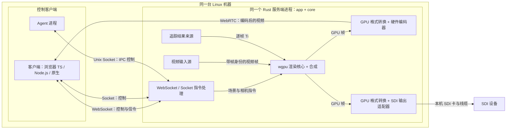

# 渲染服务端与客户端设计

状态：设计方案，尚未实现。目前还没有 SDI 信号源和输出卡，
因此第一阶段使用模拟的输入、追踪结果和 SDI 输出（见第 6 节）。

所有软件组件均运行在同一台 Linux 机器上。
本机安装的 SDI 输出卡可以向外部 SDI 设备输出视频。
本方案不包含 Windows 支持、跨机器的软件连接或远程部署。

英文版：`render-server-client-design.md`。
更新设计时，中英文版本必须同步。

## 1. 控制与输出通道

**WebSocket 和 Socket 传控制指令；一次 GPU 渲染同时服务 WebRTC 和 SDI 两路输出。**

| 通道 | 用途 | 端点 |
| --- | --- | --- |
| WebSocket | 发送指令、接收结果与状态，同时交换 WebRTC 信令。 | 浏览器或 Node.js TypeScript 客户端。 |
| Socket | 发送相同的指令，接收相同的结果与状态。 | Node.js 客户端或原生工具。 |
| Agent IPC（Socket） | 使用相同的指令协议发送指令、接收结果与状态。 | Agent 进程。 |
| WebRTC | 将渲染结果编码成实时视频流并传输。 | 浏览器 TypeScript 客户端。 |
| SDI | 通过本机输出卡传输未压缩视频。 | 外部 SDI 设备。 |

这里的 Socket 指 Unix Domain Socket（UDS）。Agent 使用同一套 Socket 后端，
不需要单独的协议或特权指令通道。
浏览器不能直接访问这些 Socket 端点，因此通过 WebSocket 接入。
选择依据是客户端运行环境，而不是机器位置。

## 2. 总览

视频输入源、追踪结果来源和 SDI 输出适配器都是可替换的边界。
第一阶段使用模拟实现，第二阶段替换为硬件和追踪服务（见第 6 节）。

WebSocket 和 Socket 是**同一套指令处理逻辑**的不同入口。
Agent 通过 Socket 接入，与 UI 共用相同的校验、授权、指令队列和权威场景状态。
不为 Agent 单独维护渲染器，也不绕过正常的指令处理逻辑。
WebRTC 和 SDI 是相互独立的输出通道，不负责传输指令。
图中的客户端节点统一表示不同运行环境，并不要求同时使用全部通道。
浏览器使用 WebSocket 和 WebRTC；Node.js/原生客户端可通过 Socket 发送控制指令。
浏览器播放和 SDI 输出使用同一份渲染场景，SDI 不经过浏览器或 WebRTC。

## 3. 职责划分

| 模块 | 职责 |
| --- | --- |
| `client/src/` | 发送指令、显示 WebRTC 视频；为 Node.js 客户端提供本机 Socket 适配器。 |
| `render/crates/app/` | 在同一进程内运行渲染器和服务端，处理 UI/Agent 指令，管理输入源、追踪结果来源以及独立的 WebRTC/SDI 输出模块。 |
| `render/crates/core/` | 管理场景与相机状态、使用 wgpu 渲染 GPU 帧的库；不依赖网络协议、采集卡或输出卡。 |
| `common/src/` | 定义 Rust 和 TypeScript 共用的指令、响应与事件协议。 |

Agent 是使用共享协议的独立控制进程，本设计不限定其运行时和代码目录。

以上为目标目录结构。Cargo 包名仍为 `chr-app` 和 `chr-core`。
**wgpu 渲染器与服务端运行在同一个进程内**，不拆成独立服务。
客户端仍是独立的。这样可以避免服务端与渲染器之间的跨进程 GPU 纹理共享。

同进程不等于同线程：使用渲染工作线程与异步网络任务，
通过有界指令队列协作，避免 GPU 工作阻塞网络 I/O。
两路输出模块先放在 `app` 内，不需要额外服务或复杂的传输框架。

## 4. 基本流程

1. UI 通过 WebSocket 或 Socket 接入；Agent 通过同一台 Linux 机器上的
   Unix Domain Socket 接入。
2. 浏览器另外通过 WebSocket 交换 WebRTC 信令，建立视频通道。
3. UI 或 Agent 发送指令，例如修改相机。服务端校验指令，通过核心应用修改，
   然后返回处理结果。
4. 核心只渲染一次 GPU 帧。服务端独立地将其交给硬件编码/WebRTC 链路，
   供浏览器播放，同时交给 SDI 输出适配器。

在现场运行时中，帧由视频输入驱动：核心使用对应帧的追踪结果渲染叠加层，
合成到输入画面上，再交给两路输出（见第 6 节）。

只发送控制指令的客户端不需要 WebRTC。指令响应表示操作结果，
并不表示客户端已经显示了对应的新画面。
Agent 无需建立视频连接即可控制渲染。UI 和 Agent 的请求必须关联到各自的来源连接，
场景修改则统一进入同一条串行指令执行路径。

## 5. GPU 帧与双输出

目标是避免原始像素回读 CPU，而不是让 CPU 完全不参与。
CPU 仍负责指令、资源管理、调度与信令。

| 输出 | 目标数据链路 | CPU 参与 |
| --- | --- | --- |
| WebRTC | GPU 纹理 → GPU 颜色转换 → 硬件编码 → WebRTC → 浏览器硬件解码与显示。 | 压缩码流及协议处理通常仍经过 CPU/系统内存。 |
| SDI | GPU 纹理 → 所需的 GPU 格式转换 → 受支持的直接 DMA 路径 → SDI 卡。 | 负责调度与同步；像素完全不经过主存需要具体硬件和 SDK 支持。 |

WebRTC 先验证 H.264 硬件编码，例如 NVENC。
NVENC 使用专用硬件编码单元，而不是渲染着色器。
单帧编码可以达到毫秒级，但这不是本项目的实测结果，也不代表完整显示延迟。

采用低延迟编码配置，避免 B 帧重排和前瞻，并限制队列长度。
在目标 Linux 系统上验证纹理互操作和浏览器硬件解码。
允许 GPU 内部的格式转换或拷贝；未经验证，不将完整链路称为零拷贝。

SDI 需要验证具体输出卡、GPU、驱动、SDK、操作系统及 PCIe 拓扑。
支持采集直接进入 GPU，不代表支持 GPU 直接输出 SDI。
GPUDirect 名称也不等于像素完全绕过主存。
直接输出路径不受支持时应明确报错，不能静默回退到 CPU 回读。

两路输出不能互相阻塞。各自使用有界队列，必要时在编码前丢弃过时的 WebRTC 帧。
SDI 按选定视频制式的硬件节奏调度，并明确欠帧处理策略。
若 SDI 是正式节目输出，其时序优先于浏览器预览。

使用有界 GPU 帧池和 GPU 完成信号；消费者使用结束前不能复用对应纹理，
也不能允许慢消费者无限期占用帧。两路输出可使用不同的像素格式与分辨率。

## 6. 分阶段交付与可替换边界

目前还没有 SDI 信号源和输出卡。因此第一阶段用模拟的边界跑通完整链路，
第二阶段在硬件选定并验证后替换这些边界。两个阶段使用相同的指令语义、
帧处理链路和输出调度，接入硬件时只替换实现，不重构链路。
这也符合 #1 中“业务需支持模拟与重放”的要求。

#1 确认的现场运行时由输入驱动：采集 → 追踪 → 渲染/合成 → 输出。
从一开始就把每个边界设计成可替换的接口，而不是先只做输出链路。

| 边界 | 第一阶段（模拟） | 第二阶段（硬件） |
| --- | --- | --- |
| 视频输入 | 解码本地视频文件或生成测试画面；每帧带帧身份和时间码。 | SDI 采集卡（Cam1）。 |
| 追踪结果 | 录制的或人工生成的逐帧 Ti，按帧身份对应。 | 实时追踪服务。 |
| 渲染与合成 | 真实实现：渲染叠加层并合成到输入画面上。 | 不变。 |
| 浏览器预览 | 真实实现：GPU 硬件编码 → WebRTC。 | 不变。 |
| SDI 输出 | 模拟输出端：按固定节奏、以 SDI 像素格式输出，写入文件或逐帧导出。 | SDI 输出卡。 |
| 时钟 | 可控时钟，支持暂停、单步和加速。 | 硬件参考时钟或锁定输入信号的时序。 |

帧身份由输入源产生，随每一帧经过追踪、合成和两路输出，
不能用缓存槽或输出帧计数代替。某帧没有对应追踪结果时如何处理，在 #1 中仍待决；
需要明确规定，而不是静默沿用过期结果。

模拟 SDI 输出端要模拟输出约束，而不只是“有画面输出”：

- 按选定视频制式的节奏出帧，由可控时钟驱动。
- 使用有界队列，统计欠帧次数，并执行约定的欠帧策略，例如重复上一帧。
- 在 GPU 上转换为目标 SDI 像素格式，例如 10-bit YUV 4:2:2，以便接入真实硬件时复用。
- 可以将像素回读到 CPU 以写入文件，但要标明仅用于模拟；
  这不放宽 WebRTC 链路和硬件 SDI 链路“不回读原始像素”的要求。

第一阶段不包括选定 SDI 卡或 SDK、验证 GPU 到 SDI 卡的直接传输路径、
硬件 genlock，也不对 SDI 延迟作任何承诺；这些属于第二阶段。
有了同时支持输入和输出的采集卡后，可以把它的输出接回自身输入，
不依赖外部信号源即可自测。

## 7. 延迟与验证

同机硬编码 WebRTC 可以先按 **GPU 完成一帧到浏览器显示约 50–150 ms**
做工程预算。这不是实测值、性能保证或 WebRTC 固定延迟。
应分别测量编码、排队、接收缓冲、解码和显示，并统计端到端 P50/P95。
指令到画面的延迟还要加上指令处理与渲染调度。

每多缓冲一帧，在 60 FPS 下约增加 16.7 ms，在 30 FPS 下约增加 33.3 ms。
编码速度快，不能抵消队列持续积压；浏览器播放与 SDI 输出也不会自动同步。

先支持一个渲染会话、一个 TS 客户端和一个 Agent Socket 连接。
第一阶段使用第 6 节的模拟输入、模拟追踪结果和模拟 SDI 输出端。
验证 UI 与 Agent 的指令修改同一个场景，响应返回正确的调用方。
首先在 720p/30 FPS 下打通相机控制和浏览器播放，再在硬件支持时评估低延迟 1080p60。
第二阶段根据实际输出卡和下游设备确定 SDI 制式。以上均为验证目标，而非性能保证。

## 8. 第一版约定

- WebSocket 与 Socket（包括 Agent 连接）使用相同的 JSON 指令、响应定义及请求 ID。
  统一的是指令处理，不是平台底层句柄。
- 一条 WebSocket 消息对应一条协议消息。本机字节流使用
  “4 字节大端消息体长度 + JSON 字节”的分帧方式。
- 限制消息大小与队列长度。合并过时的相机更新，
  但不能静默丢弃重要指令。
- 指令始终走 WebSocket/Socket，浏览器画面走 WebRTC，SDI 使用独立输出链路；
  不引入 DataChannel 指令通道，也不将连续发送 PNG 作为主要视频方案。
- WebSocket 监听器仅绑定回环地址，不监听所有网络接口。
  校验浏览器来源与会话身份，Socket 使用 Linux 目录/socket 权限限制访问，
  必要时校验对端身份。Agent 与 UI 指令使用相同的授权规则。
- 本机 WebRTC 视频仍需信令交换和 ICE 协商。
  第一版不配置外部 STUN/TURN 服务，需要在目标浏览器中验证本机连通性。
- 验证 Linux 的 GPU 到编码器链路。
  现有阻塞式 CPU 回读函数保留用于截图和测试，不作为目标连续视频输出路径。
