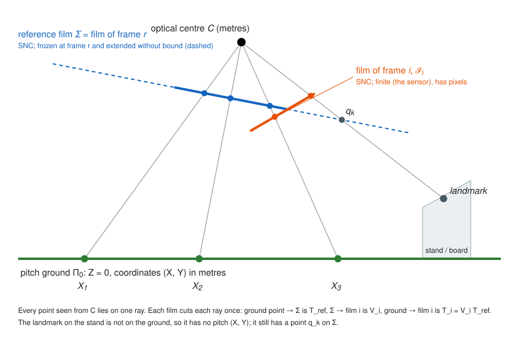
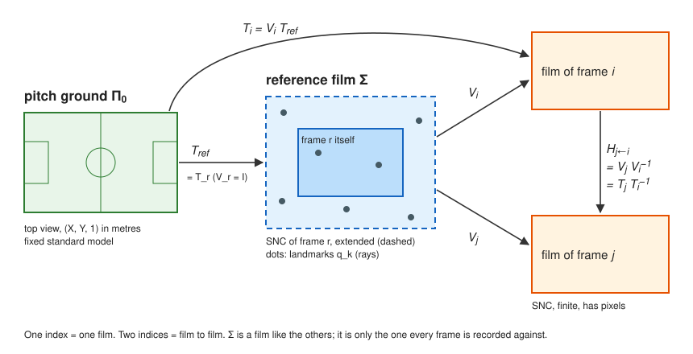
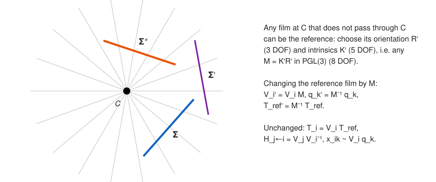

# vchao atlas, V, Ti and T_ref

**Status:** `draft` — an explanation of vchao's geometry for chr readers. vchao's
own documents are authoritative; this page follows the pinned submodule
`external/vchao` (`f209fc9`).

**Scope:** what "atlas" means in vchao, the three products the word is used for,
an intuitive picture with diagrams and units, and a formal statement of the geometry that connects $K$, $R$, $C$, $H$, $V$,
$q$, $T_{\mathrm{ref}}$ and $T_i$ (vchao's `Ti`), and the offline (map
building) and online (per-frame) algorithms. It does not define a chr protocol. The paired translation is [vchao-atlas.zh-CN.md](vchao-atlas.zh-CN.md).

Sources in `external/vchao`: `README.md` (`Atlas`), `docs/camera-geometry.md`
(the preamble before the contents, and sections 3, 6, 8 and 9),
`projective-atlas/README.md` and `atlas-vq-estimate/README.md`.

## Three things called "atlas"

| | vchao name | Reference coordinates | Contents | Pixels | State |
|---|---|---|---|---|---|
| ① | **`Atlas`** (canonical) | The station's **physical** directions (calibrated) | Per camera station: square charts, 12 headings x 3 pitches, K = I, 90° FOV; chart rotations, static reference imagery, coverage | Yes | Design only, not implemented |
| ② | Uncalibrated projective panorama (output of `projective-atlas`) | **An arbitrary chosen frame**, displayed as if K = I | The same 36-chart layout filled with the per-channel temporal median of the registered frames' RGB | Yes | Implemented; for display and evaluation |
| ③ | Anchored **V/Q map** (the manifest read by `atlas-vq-estimate`) | The reference plane chosen when the map was built | Landmarks q with descriptors, each view's V, and T_ref | **No** | Implemented; **this is what live Ti estimation uses** |

- In vchao, `Atlas` strictly means ①. vchao calls the panorama ② distinct from
  the canonical Atlas. The V/Q map ③ is a separate projective, uncalibrated
  product, not the canonical Atlas either. ② and ③ are both registrations in the
  sense of Definition 3 below, but not necessarily the same one: the V/Q map
  keeps its own fitted $V$ and $q$, which must stay together.
- "We need an atlas to estimate Ti live" refers to the V/Q map **③**.
- chr's business documents ([calibration records](calibration-control.md),
  [system architecture](system-architecture.md)) use "atlas" loosely for
  "reference images, each with its pitch Ti, plus C". That is closest to the V/Q
  map's `views` table (frames with $V$ and an optional $T_i$) and is not vchao's
  canonical `Atlas`.

## Naming

- **V/Q map** is vchao's name (`atlas-vq-estimate`) for the stored pair of
  **V**, the views' homographies $V_i : \Sigma \to \mathcal{I}_i$ (table `views`,
  column `v`), and **Q**, the landmarks (table `landmarks`, column `q`), plus the
  observations linking them and a manifest with the anchor and $T_{\mathrm{ref}}$.
  The slash is not a quotient, although a map's content is one (section 8).
- This page writes one landmark as $q_k$: one row of vchao's Q. It is a ray from
  the optical centre (Definition 4), not a 3D or pitch point.
- $Q_a$ in Definition 5 is a chart rotation (vchao's `camera-geometry.md`
  notation), unrelated to the landmarks Q. The gauge matrix is $M$.

## Intuition: one optical centre, many films

### Three planes

The station's optical centre $C$ never moves. Everything the camera sees lies
on a ray from $C$. Three planes cut those rays:

| Plane | What it is | Coordinates | Extent |
|---|---|---|---|
| Pitch ground $\Pi_0$ | The real grass, $Z = 0$ | $(X, Y)$ in metres, the standard top view | The pitch |
| Film of frame $i$, $\mathcal{I}_i$ | Frame $i$'s image plane (the sensor, drawn upright in front of $C$) | SNC of frame $i$ | Finite; it has pixels |
| Reference film $\Sigma$ | The film of one chosen frame $r$, frozen at that moment | SNC of frame $r$ | Extended without bound |

The reference film is **a film like any other**: geometrically, $\Sigma$ and
$\mathcal{I}_i$ are the same kind of object, and $V_i$ is the same kind of map
as a frame-to-frame homography. Only the role differs: $\Sigma$ is the one film
every frame is recorded against.

Each map follows one ray from one plane to another:

- $T_{\mathrm{ref}}$: a ground point $X$, along the ray $CX$, to where that ray
  crosses $\Sigma$. Because $V_r = I$, $T_{\mathrm{ref}} = T_r$: it is simply
  **the pitch as seen by the reference frame**.
- $V_i$: a point of $\Sigma$, along the same ray, to frame $i$'s film. With
  $V_r = I$, $V_i = H_{i \leftarrow r}$.
- $T_i = V_i T_{\mathrm{ref}}$: the ground to frame $i$'s film, through $\Sigma$.
- $q_k$: where a landmark's ray crosses $\Sigma$. The landmark in the figure is
  on a stand, not on the ground, so it has no pitch coordinates; it still has a
  point on $\Sigma$. This is why registration uses $\Sigma$ and not the ground.

### Maps and indices

One index means one film: $V_i$ ($\Sigma \to \mathcal{I}_i$) and $T_i$
($\Pi_0 \to \mathcal{I}_i$). Two indices mean film to film:
$H_{j \leftarrow i} = V_j V_i^{-1} = T_j T_i^{-1}$ (the second form only for
ground points). $T_{\mathrm{ref}}$ has no frame index; it is a constant of the
station.

| | Reference film $\Sigma$ | Film of frame $i$ |
|---|---|---|
| Number | One per map | One per frame, changing over time |
| Extent | Unbounded | The sensor |
| Pixels | Not needed; it can be a film never exposed (the $K = I$ charts of ①) | Yes, the captured picture |
| Holds | Landmarks $q_k$ and $T_{\mathrm{ref}}$ | Observations $x_{ik}$ |

One shared film is used because:

1. $N$ frames need $N$ maps $V_i$ instead of $N^2$ pairs, and pairs derived as
   $V_j V_i^{-1}$ are consistent around every loop.
2. A landmark seen in 100 frames is stored once, as one $q_k$.
3. A live frame only needs its own $\hat V_f$, not a match to every past frame.
4. The pitch is attached once, by the constant $T_{\mathrm{ref}}$.

This is the same choice as taking the first camera's frame as the world frame
in SLAM.

### There are infinitely many reference films

Any plane not through $C$ can be the reference film: choose its orientation
$R'$ (3 degrees of freedom) and intrinsics $K'$ (5), that is, any
$M = K'R' \in \mathrm{PGL}(3)$ (8). Changing the reference by $M$ changes
$V_i \mapsto V_i M$, $q_k \mapsto M^{-1} q_k$ and
$T_{\mathrm{ref}} \mapsto M^{-1} T_{\mathrm{ref}}$, and leaves every physical
quantity ($T_i$, $H_{j \leftarrow i}$, the observations) unchanged. vchao
chooses the middle frame of a shot; the canonical Atlas ① chooses 36 films with
$K = I$ and known orientations. $q$, $V$ and $T_{\mathrm{ref}}$ of one map must
come from the same choice.

## Units

| Quantity | Maps or lives in | Unit |
|---|---|---|
| $X, Y, Z$; $C$ | World | Metres, pitch-centred; up is $-Z$ |
| $(u, v)$ | Native image | Pixels, integer pixel centres |
| SNC point $(x, y)$ | Film of a frame | Dimensionless: $x = (2u - W)/s$, $y = (2v - H)/s$, $s = \sqrt{WH}$. For 1920 x 1080, $s = 1440$, so $x \in [-1.33, 1.33]$ and $y \in [-0.75, 0.75]$ |
| Point of $\Sigma$; $q_k$ | Reference film | The reference frame's SNC; homogeneous, so only the ratio $q_1 : q_2 : q_3$ matters. On a canonical chart ($K = I$), $x$ and $y$ are tangents of the angle from the chart's axis |
| $K_i$ | Intrinsics in SNC | Dimensionless: $f_{\mathrm{SNC}} = f_{\mathrm{px}} / (s/2)$; the half field of view across $x$ is $\arctan\big((W/s) / f_{\mathrm{SNC}}\big)$ |
| $V_i$, $H_{j \leftarrow i}$ | Film to film | Dimensionless 3 x 3, stored with $\det = 1$ |
| $T_i$, $T_{\mathrm{ref}}$ | Ground to film | Input $(X, Y, 1)$ in metres, output homogeneous SNC. Changing the length unit by $X' = cX$ replaces $T$ with $T\,\mathrm{diag}(1/c, 1/c, 1)$ |
| $D_i$ | Film to direction | Dimensionless |
| $G_0(C)$ | | First two columns dimensionless, third column $-C$ in metres |
| $\Lambda_f$ | Native pixels to SNC | Scale $2/s$ per pixel |
| $\rho_3$ threshold, RANSAC inliers | Native image | Pixels |

## Formal statement

### 0. Notation

- $\mathbb{P}^2 = (\mathbb{R}^3 \setminus \lbrace 0 \rbrace)/\mathbb{R}^\times$
  is the real projective plane. For $x, y \in \mathbb{R}^3 \setminus \lbrace 0 \rbrace$,
  $x \sim y$ means $x = \lambda y$ for some $\lambda \neq 0$; $[x]$ is the class of $x$.
- $\mathrm{PGL}(3) = \mathrm{GL}(3)/\mathbb{R}^\times$ acts on $\mathbb{P}^2$ by
  $[x] \mapsto [Mx]$ (column vectors). Because $3$ is odd,
  $\mathrm{SL}(3) \to \mathrm{PGL}(3)$ is a bijection, and
  $N(M) = M / \sqrt[3]{\det M}$ (real cube root) is the determinant-one
  representative vchao stores (vchao's `N(H)`; `atlas-vq-estimate` calls it
  `canon`, which is not the $K_{33} = 1$ camera gauge `canon` of
  `camera-geometry.md`).
- The world is $W = \mathbb{R}^3$ in pitch metres, with ground plane
  $\Pi_0 = \lbrace Z = 0 \rbrace$ and standard basis $e_1, e_2, e_3$
  (up is $-e_3$, see the [coordinate contract](../server/docs/coordinates.md)).
- Each frame $i$ has an image plane $\mathcal{I}_i \cong \mathbb{P}^2$ in
  undistorted SNC coordinates. Lens distortion $\psi_i$ acts after projection
  and is omitted below.
- $\varphi(x) = (x_1/x_3,\ x_2/x_3)$ is dehomogenisation.
- A frame of $W_f \times H_f$ native pixels has $s_f = \sqrt{W_f H_f}$, and
  $\Lambda_f$ maps native pixel coordinates $(u, v, 1)^\top$ to SNC:

$$
\Lambda_f = \frac{1}{s_f} \begin{bmatrix} 2 & 0 & -W_f \\ 0 & 2 & -H_f \\ 0 & 0 & s_f \end{bmatrix}.
$$

- For $h \in \mathbb{R}$ and $C \in \mathbb{R}^3$,

$$
G_h(C) = \begin{bmatrix} e_1 & e_2 & h\,e_3 - C \end{bmatrix} \in \mathbb{R}^{3\times 3},
\qquad \det G_h(C) = h - C_z .
$$

### 1. Cameras

**Definition 1 (pinhole camera).** Frame $i$ has intrinsics $K_i$ (upper
triangular, $f_x, f_y > 0$, $(K_i)_{33} = 1$), world-to-camera rotation
$R_i \in \mathrm{SO}(3)$ and optical centre $C_i \in W$. Its projection and
direction matrices are

$$
P_i = K_i R_i \begin{bmatrix} I & -C_i \end{bmatrix} \in \mathbb{R}^{3\times 4},
\qquad
D_i = R_i^\top K_i^{-1} \in \mathrm{GL}(3).
$$

An image point $[p] \in \mathcal{I}_i$ back-projects to the ray
$\lbrace C_i + t\,D_i p : t \in \mathbb{R} \rbrace$.

**Proposition 1 (plane homographies).** Let
$E_h : (X, Y, 1)^\top \mapsto (X, Y, h, 1)^\top$ embed the horizontal plane at
height $h$. Then

$$
A_{i,h} := P_i E_h = D_i^{-1} G_h(C_i),
$$

which lies in $\mathrm{PGL}(3)$ if and only if $h \neq C_{i,z}$. The pitch
homography is

$$
T_i := A_{i,0} = D_i^{-1} G_0(C_i) = K_i R_i \begin{bmatrix} e_1 & e_2 & -C_i \end{bmatrix}.
$$

*Proof.* $\begin{bmatrix} I & -C \end{bmatrix} E_h = G_h(C)$ and $K_i R_i = D_i^{-1}$. $\square$

**Proposition 2 (3D points from $T_i$ and $C$).** If $C_{i,z} \neq 0$, every
$X \in W \setminus \lbrace C_i \rbrace$ projects to

$$
p \sim T_i\, G_0(C_i)^{-1} (X - C_i).
$$

*Proof.* $P_i (X, 1)^\top = D_i^{-1}(X - C_i)$, and $T_i = D_i^{-1} G_0(C_i)$ with
$G_0(C_i)$ invertible gives $D_i^{-1} = T_i\, G_0(C_i)^{-1}$. $\square$

So rendering objects above the ground needs exactly $(T_i, C_i)$.

### 2. Stations

**Definition 2 (station).** A station is a set of frames $F$ with a common
optical centre: $C_i = C$ for all $i \in F$.

**Proposition 3.** For $i, j \in F$, corresponding image points are related by

$$
H_{j \leftarrow i} = \left[ D_j^{-1} D_i \right] \in \mathrm{PGL}(3),
$$

independently of scene depth.

*Proof.* For $X = C + t\,D_i p$ with $t \neq 0$,
$P_j (X, 1)^\top = D_j^{-1}(X - C) = t\, D_j^{-1} D_i\, p$. $\square$

### 3. Registrations and the reference plane

**Definition 3 (registration).** A registration of a station $F$ is a family
$(V_i)_{i \in F} \subset \mathrm{PGL}(3)$ with

$$
H_{j \leftarrow i} = V_j V_i^{-1} \qquad \text{for all } i, j \in F .
$$

The common domain $\Sigma \cong \mathbb{P}^2$ of the maps $V_i : \Sigma \to \mathcal{I}_i$
is the **reference plane** (the panorama plane), and $U_i := V_i^{-1}$.

**Proposition 4 (existence and gauge).**

1. For every $A \in \mathrm{GL}(3)$, $V_i = [D_i^{-1} A]$ is a registration.
2. Two registrations $V, V'$ of the same station satisfy $V'_i = V_i M$ for one
   $M \in \mathrm{PGL}(3)$ and all $i$. The registrations form a right
   $\mathrm{PGL}(3)$-torsor.
3. Every registration has the form $V_i = [D_i^{-1} A]$, with $A = D_r V_r$ for
   any $r \in F$.

*Proof.* (1) $V_j V_i^{-1} = D_j^{-1} A A^{-1} D_i = H_{j \leftarrow i}$.
(2) $V'_j V'^{-1}_i = V_j V_i^{-1}$ gives $V_j^{-1} V'_j = V_i^{-1} V'_i$, a
constant $M$. (3) $D_i^{-1} D_r V_r = H_{i \leftarrow r} V_r = V_i V_r^{-1} V_r = V_i$. $\square$

**Interpretation.** A point $[s] \in \Sigma$ is the ray through $C$ with
direction $[A s]$, because $p = V_i s$ gives $D_i p = A s$. So $\Sigma$ is the
space of rays at the optical centre, coordinatised by $A$; it is neither a
top-down view nor 3D. With the root fixed by $V_r = I$, $A = D_r$ and $\Sigma$
is frame $r$'s image plane.

**Identifiability.** The family $\lbrace H_{j \leftarrow i} \rbrace$ does not
determine $A$. The angle between the rays of $s, s' \in \Sigma$ is

$$
\cos \angle(s, s') = \frac{s^\top \omega_\Sigma\, s'}{\sqrt{s^\top \omega_\Sigma\, s}\ \sqrt{s'^\top \omega_\Sigma\, s'}},
\qquad \omega_\Sigma := A^\top A ,
$$

and in an uncalibrated registration $\omega_\Sigma$ is unknown.

### 4. Landmarks (the V/Q map ③)

**Definition 4 (landmark).** A landmark is a point $q_k \in \Sigma$ with a
descriptor $d_k \in \mathbb{R}^{128}$. Its observation in frame $i$ satisfies

$$
x_{ik} \sim V_i\, q_k \qquad \text{(up to measurement noise).}
$$

$q_k$ is a ray, not a metric 3D point; $q_{k,3} = 0$ is allowed and is a point
at infinity of $\Sigma$'s affine chart.

Building a map is the estimation problem

$$
\min_{\lbrace V_i \rbrace,\ \lbrace q_k \rbrace}\ \sum_{i,k} \rho\left( \left\lVert \varphi(V_i q_k) - x_{ik} \right\rVert \right),
$$

whose solution is unique only up to the gauge
$(V_i, q_k) \mapsto (V_i M, M^{-1} q_k)$. vchao consumes a built map and does
not document how it is produced.

### 5. Anchoring to the pitch

**Proposition 5.** Let $C_z \neq 0$ and let $V$ be a registration. There is a
unique $T_{\mathrm{ref}} \in \mathrm{PGL}(3)$ with

$$
T_i = V_i\, T_{\mathrm{ref}} \qquad \text{for all } i \in F,
$$

namely

$$
T_{\mathrm{ref}} = \left[ A^{-1} G_0(C) \right] = V_a^{-1} T_a \qquad \text{for any anchor } a \in F .
$$

*Proof.* Existence: $V_i A^{-1} G_0(C) = D_i^{-1} G_0(C) = T_i$. Uniqueness:
$V_i$ is invertible. The anchor form follows from $T_a = V_a T_{\mathrm{ref}}$. $\square$

$T_{\mathrm{ref}} : \Pi_0 \to \Sigma$ sends a ground point to the ray through
it. Under the gauge $V_i \mapsto V_i M$, $T_{\mathrm{ref}} \mapsto M^{-1} T_{\mathrm{ref}}$
and $V_i T_{\mathrm{ref}}$ is unchanged.

**Proposition 6 (recovering $A$).** If $C$ is known and $C_z \neq 0$, then

$$
A \sim G_0(C)\, T_{\mathrm{ref}}^{-1}, \qquad D_i^{-1} \sim V_i A^{-1},
$$

and the RQ decomposition of $V_i A^{-1}$, with the sign fixed by $\det R_i = 1$
and the scale by $(K_i)_{33} = 1$, gives $K_i$ and $R_i$ uniquely. Without $C$,
the anchor alone does not determine $A$; constraints on $K$ (zero skew, square
pixels) are needed to solve for $C$ and $A$ together.

### 6. Live estimation (`atlas-vq-estimate`)

Given a V/Q map $\lbrace (q_k, d_k) \rbrace$, $T_{\mathrm{ref}}$ and a new frame $f$:

**Step 1 (matching).** ALIKED features of $f$ are matched to the descriptors
$d_k$ (mutual nearest neighbours with ratio tests), giving correspondences
$\lbrace (x_m, q_{k(m)}) \rbrace$, with $x_m$ in native pixels.

**Step 2 (resection).** RANSAC initialises, then damped Gauss-Newton solves the
homography resection $\Sigma \to \mathcal{I}_f$ (8 degrees of freedom, at least
4 correspondences). Residuals are measured in native pixels and $\rho_3$ is
the Huber loss with a 3-pixel threshold:

$$
\hat V_f = \operatorname*{arg\,min}_{V \in \mathrm{PGL}(3)}\ \sum_m \rho_3\left( \left\lVert \varphi\left(\Lambda_f^{-1} V q_{k(m)}\right) - x_m \right\rVert \right).
$$

**Step 3 (output).**

$$
T_f = N\left( \hat V_f\, T_{\mathrm{ref}} \right).
$$

The map's $V_i$, $q_k$ and $T_{\mathrm{ref}}$ stay fixed. $C$, $K$ and $R$ are
not estimated.

### 7. The canonical Atlas ① and the panorama ②

**Definition 5 (canonical Atlas).** For a station with centre $C$, let
$u = (0, 0, -1)^\top$ be world up and $O$ the pitch centre, and define

$$
b_3 = \frac{O - C}{\lVert O - C \rVert}, \qquad
b_1 = \frac{b_3 \times u}{\lVert b_3 \times u \rVert}, \qquad
b_2 = b_3 \times b_1, \qquad
S = \begin{bmatrix} b_1 & b_2 & b_3 \end{bmatrix} \in \mathrm{SO}(3).
$$

Chart $a$ with rotation $Q_a \in \mathrm{SO}(3)$ relative to the station is the
registration with

$$
A = D_a := S\, Q_a \quad (K_a = I), \qquad
H_{a \leftarrow i} = D_a^{-1} D_i = Q_a^\top S^\top D_i ,
$$

and the pitch projects onto it by $T_{\mathrm{ref}}^{(a)} = D_a^{-1} G_0(C)$,
independently of any frame. Here $\omega_\Sigma = A^\top A = I$ and the
orientation is known, so Euclidean angles on the chart are physical ray angles.

**Definition 6 (projective panorama).** Choose a root $r$ with $V_r = I$ and
**assume** $\omega_\Sigma = I$. A display chart $c$ with rotation $R_c$ sends
chart point $u$ to $V_i R_c u$ in frame $i$, and its colour is the per-channel
median of the frames' colours $\mathrm{RGB}_i$

$$
B_c(u) = \operatorname{median} \left\lbrace \mathrm{RGB}_i\left( V_i R_c u \right) : V_i R_c u \text{ inside frame } i \right\rbrace .
$$

The true value is $\omega_\Sigma = D_r^\top D_r = K_r^{-\top} K_r^{-1} \neq I$
in general, so chart angles are not physical.

**Relation.** ② and ③ are registrations (Definition 3) with unknown $A$; ① is
the registration whose $A$ is a known physical rotation. Upgrading ② or ③ to ①
needs exactly the conditions of Proposition 6.

### 8. The V/Q map as a quotient

The slash in "V/Q" only means "V and Q". Mathematically, though, the content of
a map is a quotient, in two layers.

**Layer 1: each element is a class.** $V_i \in \mathrm{PGL}(3) = \mathrm{GL}(3)/\mathbb{R}^\times$
and $q_k \in \mathbb{P}^2 = (\mathbb{R}^3 \setminus \lbrace 0 \rbrace)/\mathbb{R}^\times$
are defined only up to a nonzero factor. Storage picks representatives:
$N(V_i)$ with $\det = 1$, and any nonzero float64 triple for $q_k$.

**Definition 7 (representatives and the gauge action).** Let $I \subseteq F$
be the map's views and $\mathcal{K}$ its landmarks. A representative of a map is

$$
\mathbf{m} = \left( (V_i)_{i \in I},\ (q_k)_{k \in \mathcal{K}},\ T_{\mathrm{ref}} \right)
\in \mathcal{R} := \mathrm{PGL}(3)^{I} \times (\mathbb{P}^2)^{\mathcal{K}} \times \mathrm{PGL}(3).
$$

Descriptors $d_k$ and observations $x_{ik}$ are attached to the indices and are
not acted on. The gauge group $G = \mathrm{PGL}(3)$ acts on the right by

$$
\mathbf{m} \cdot M = \left( (V_i M)_i,\ (M^{-1} q_k)_k,\ M^{-1} T_{\mathrm{ref}} \right).
$$

This is a right action: $(\mathbf{m} \cdot M) \cdot M' = \mathbf{m} \cdot (M M')$
because $(MM')^{-1} = M'^{-1} M^{-1}$.

**Layer 2: the map is an orbit.** The physical content of a map is its orbit
$\mathbf{m} \cdot G$, a point of the quotient

$$
\mathcal{M} = \mathcal{R} / G .
$$

**Proposition 7 (invariants).** The following are constant on every orbit:

$$
T_i = V_i\, T_{\mathrm{ref}}, \qquad
H_{j \leftarrow i} = V_j V_i^{-1}, \qquad
[\,V_i\, q_k\,] \in \mathcal{I}_i .
$$

*Proof.* $V_i M \cdot M^{-1} T_{\mathrm{ref}} = V_i T_{\mathrm{ref}}$,
$V_j M (V_i M)^{-1} = V_j V_i^{-1}$ and $V_i M \cdot M^{-1} q_k = V_i q_k$. $\square$

**Proposition 8 (free action).** $G$ acts freely on $\mathcal{R}$: every orbit
is a $G$-torsor, in bijection with $\mathrm{PGL}(3)$. Hence

$$
\dim \mathcal{M} = \dim \mathcal{R} - 8 = 8\,|I| + 2\,|\mathcal{K}| .
$$

*Proof.* $\mathbf{m} \cdot M = \mathbf{m}$ implies $V_i M = V_i$ in
$\mathrm{PGL}(3)$, so $M = I$. $\square$

**Proposition 9 (the invariants determine the orbit).** If $\mathbf{m}$ and
$\mathbf{m}'$ have the same $H_{j \leftarrow i}$ for all $i, j \in I$, the same
$T_r$ and the same $[V_r q_k]$ for all $k$, for one $r \in I$, then
$\mathbf{m}' = \mathbf{m} \cdot M$ with $M = V_r^{-1} V'_r$.

*Proof.* $V'_i = H_{i \leftarrow r} V'_r = V_i V_r^{-1} V'_r = V_i M$;
$T'_{\mathrm{ref}} = V'^{-1}_r T_r = M^{-1} V_r^{-1} T_r = M^{-1} T_{\mathrm{ref}}$;
$[V'_r q'_k] = [V_r q_k]$ gives $[q'_k] = [V'^{-1}_r V_r q_k] = [M^{-1} q_k]$. $\square$

So a map's physical content is exactly its invariants: the frame-to-frame
homographies, the pitch homographies and where each landmark appears.

**Gauge fixing: the reference frame is a section.** For $r \in I$, the slice
$\mathcal{S}_r = \lbrace \mathbf{m} : V_r = I \rbrace$ meets every orbit exactly
once, at $\mathbf{m} \cdot V_r^{-1}$, because $V_r M = I$ forces $M = V_r^{-1}$.
Hence $\mathcal{M} \cong \mathcal{S}_r$, and the representative in this slice is

$$
\mathbf{m} \cdot V_r^{-1} = \left( (H_{i \leftarrow r})_i,\ ([V_r q_k])_k,\ T_r \right):
$$

every view is its homography from frame $r$, every landmark is its position on
frame $r$'s (unbounded) film, and $T_{\mathrm{ref}}$ is frame $r$'s own pitch
homography. This is the precise sense of "everything is expressed relative to
the reference frame". The canonical Atlas ① is a different section: it fixes
$A = S Q_a$ instead of $V_r = I$, which needs the calibration of Proposition 6.

**Consequences.**

1. A stored V/Q map is one point of one slice; its numbers are coordinates in
   that gauge, not physical quantities on their own.
2. Components of different representatives must not be mixed: taking $V_i$
   from $\mathbf{m}$ and $q'_k$ from $\mathbf{m} \cdot M$ predicts
   $V_i M^{-1} q_k$ instead of $V_i q_k$, wrong unless $M = I$. This is vchao's
   rule that Q must stay with its actual fitted V lineage.
3. Live estimation is covariant: for the representative $\mathbf{m} \cdot M$,
   the fit of Section 6 returns $\hat V_f M$, because it only sees
   $x \sim V q$. The output $T_f = N(\hat V_f M \cdot M^{-1} T_{\mathrm{ref}})$ is
   unchanged.

## Algorithms

Both algorithms use the notation of the formal statement. Each step names the
vchao tool at `f209fc9` and its state: **implemented** (a CLI exists),
**planned** (a candidate in `docs/cli-contracts.md`, no CLI yet) or
**research** (done today by research code outside the vchao CLIs).

### Offline algorithm: building the map

**Input.** A sweep video of one station that pans, tilts and zooms over the
whole pitch with a fixed optical centre; the standard pitch model
$\mathcal{M}(L, W)$ (top view in pitch metres: lines, circles and goals; $L$ and $W$ are free,
default $L = 105$, $W = 68$, while local markings and goals keep fixed standard
dimensions); optionally a declared lens model $\psi$.

**Output.** The V/Q map ③ $\big(\lbrace (q_k, d_k) \rbrace, \lbrace V_i \rbrace, T_{\mathrm{ref}}\big)$,
and the optical centre $C$; optionally $L$, $W$, $K_i$, $R_i$ and $\psi$.

**Step O1 (frames of one station).** Split the video into shots and keep the
frames $F$ of one station (Definition 2); mask screen overlays.
`tracklet-shot`, `ui-mask` — implemented. The common-centre assumption is
declared by the caller, not verified.

**Step O2 (lens).** Proposition 3 holds exactly only in undistorted SNC. With a
declared $\psi$, map native pixels $\tilde u$ to
$p = \psi^{-1}\left(\varphi(\Lambda_i \tilde u)\right)$ first. vchao's current map
and estimator skip this step and work on native (distorted) pixels, treating
distortion as negligible. No vchao tool — research.

**Step O3 (texture correspondences).** Match static texture (stands, boards,
turf, lines); players, the ball and overlays are outliers. Adjacent frames:
ALIKED N16ROT with LightGlue and SEA-RAFT flow (`frame-track`, implemented).
Distant frames, for loop closure: EfficientLoFTR (`eloftr-match`,
implemented).

**Step O4 (pairwise homographies).** For each matched pair, a robust fit
(RANSAC, then a robust loss $\rho$):

$$
\hat H_{j \leftarrow i} = \operatorname*{arg\,min}_{H \in \mathrm{PGL}(3)} \sum_m \rho\left( \left\lVert \varphi(H x_{i,m}) - x_{j,m} \right\rVert \right).
$$

`sparse-fit-h-*` — planned.

**Step O5 (registration).** Solve the nodes, either from the H-graph

$$
\lbrace \hat V_i \rbrace = \operatorname*{arg\,min}_{\lbrace V_i \rbrace} \sum_{(i,j)} d\left( \hat H_{j \leftarrow i},\ V_j V_i^{-1} \right)
$$

(`solve-g-*`, planned), or jointly with the landmarks by the objective of
Section 4 (research). Fix the gauge by $V_r = I$ with $r$ the middle frame
(`projective-rebase`, implemented).

**Step O6 (landmark bank for the live frontend).** Re-extract features with
the **live** frontend (`aliked-n16`, not N16ROT), assign them to landmarks
$q_k$, and set $d_k$ to the normalised sum of the member descriptors. Only
landmarks with support $\geq 2$ enter the live matching bank. Research; there
is no exporting CLI at `f209fc9`.

**Step O7 (pitch observations).** Bright line points and segments
(`ridge-lines`, `pitch-line-gaussian-hessian-points`, implemented); semantic
points, lines and conics with known model IDs (`pitch-detect-*`, planned).

**Step O8 (anchor to the pitch).** Fit one frame $a$ to the model
(`fit-anchor-camera`, planned) and set $T_{\mathrm{ref}} = V_a^{-1} T_a$
(Proposition 5). Then refine with every frame, $V_i$ fixed
(`calibrate-shot-from-g`, planned). A model line $\ell$ maps to the image line
$T_i^{-\top} \ell$, so with observed line points $p = (x, y, 1)^\top \in \mathcal{O}_{i,\ell}$
in frame $i$:

$$
\left( \hat T_{\mathrm{ref}}, \hat L, \hat W \right) = \operatorname*{arg\,min}_{T_{\mathrm{ref}},\, L,\, W}\ \sum_i \sum_{\ell \in \mathcal{M}(L, W)} \sum_{p \in \mathcal{O}_{i,\ell}} \rho\left( \frac{\left| \left( (V_i T_{\mathrm{ref}})^{-\top} \ell \right)^\top p \right|}{\left\lVert \left( (V_i T_{\mathrm{ref}})^{-\top} \ell \right)_{1:2} \right\rVert} \right).
$$

**Step O9 (optical centre).** Ground features cannot reveal $C$
(Proposition 2); elevated ones can. With goal points $X_g$ (posts and
crossbars, height $2.44$ m) observed at $y_{i,g}$ and $T_i = V_i T_{\mathrm{ref}}$
fixed:

$$
\hat C = \operatorname*{arg\,min}_{C}\ \sum_{i,g} \rho\left( \left\lVert \varphi\left( T_i\, G_0(C)^{-1} (X_g - C) \right) - y_{i,g} \right\rVert \right).
$$

`pitch-centre-fit` — implemented (goal points and lines, three free
parameters).

**Step O10 (optional calibration).** $A \sim G_0(\hat C)\, T_{\mathrm{ref}}^{-1}$,
then $K_i$ and $R_i$ by RQ (Proposition 6), and the canonical Atlas ①
(`make-canonical-atlas`, planned).

**Step O11 (quality checks).** Render the panorama ② (`projective-atlas`),
score RGB reprojection (`h-graph-eval-rgb-reproject`) and track consistency
(`eval-track-consistency`) — implemented.

**Step O12 (export).** Write the V/Q map (`landmarks`, `observations`, `views`
and a manifest holding the anchor and $T_{\mathrm{ref}}$; see
`atlas-vq-estimate/README.md`), together with $\hat C$. Research; there is no
exporting CLI at `f209fc9`, and `atlas-vq-estimate` only loads the map.

### Online algorithm: one frame at a time

**Input.** The V/Q map, $C$, and live frames $f$ with source times $t_f$. **Output.** For every frame, in order: $T_f$ and a status
`fresh`, `interpolated`, `reused` or `unavailable`.

**Step I1 (scheduling).** `pitch-analysis` estimates scheduled targets on an
$N = 8$, $S = 4$ grid (two fresh estimates per eight frames), with one
execution slot and the newest target first. A frame held longer than
$500$ ms is emitted with the current selection. Implemented.

**Step I2 (features).** `aliked-n16` on the frame resized to a long side of
1024 (threshold $0.2$, NMS radius $2$, at most $20000$ points); keypoints map
back to native pixels $x$ with descriptors $\delta$. Implemented
(`atlas-vq-estimate`, as are I3 to I7).

**Step I3 (matching).** Match $\delta$ against the bank $\lbrace d_k \rbrace$:
mutual nearest neighbours with squared distance ratio $< 0.64$ in both
directions and squared distance $\leq 0.49$. This gives
$\lbrace (x_m, q_{k(m)}) \rbrace$.

**Step I4 (RANSAC).** At most $2048$ four-point hypotheses (seed $0$), inliers
within $3$ native pixels, early stop at $90\%$ consensus.

**Step I5 (refinement).** At most eight damped Gauss-Newton iterations on the
inliers, only $V$ free:

$$
\hat V_f = \operatorname*{arg\,min}_{V \in \mathrm{PGL}(3)}\ \sum_m \rho_3\left( \left\lVert \varphi\left(\Lambda_f^{-1} V q_{k(m)}\right) - x_m \right\rVert \right).
$$

**Step I6 (acceptance).** Accept only with at least $12$ inliers within
$3$ px, native spans of at least $10\%$ in both axes and a minimum normalised
covariance eigenvalue above $10^{-4}$; otherwise the status is
`no_features`, `no_matches` or `low_support` and no pose is made.

**Step I7 (fresh output).**

$$
T_f = N\left( \hat V_f\, T_{\mathrm{ref}} \right).
$$

**Step I8 (frames between estimates).** Between the nearest valid endpoints
$A$ and $B$, interpolate in the matrix logarithm (LogH):

$$
\Delta = N\left( T_B T_A^{-1} \right), \qquad
\alpha = \frac{t_f - t_A}{t_B - t_A}, \qquad
T_f = N\left( \exp\left( \alpha \log \Delta \right) T_A \right),
$$

with $\log$ the principal real logarithm. Without a bracket, reuse the latest
valid $T$ (`reused`), or report none (`unavailable`; never the identity).
Implemented (`pitch-analysis`, from `pitch-live`).

**Step I9 (rendering in chr).** chr receives $T_f$ in the VchaoFrame metadata.
Because I2 to I5 fit the real (distorted) native pixels, $T_f$ already maps to
the real image, and chr renders a world point $X$ pinhole at

$$
p = \varphi\left( T_f\, G_0(C)^{-1} (X - C) \right)
$$

(Proposition 2), composited before the program deadline
(`server/docs/tracking-worker.md`, `server/docs/gst-core.md`). A lens $\psi$,
$p = \psi\left(\varphi(\cdots)\right)$, applies only when the producer's $T$
maps to the undistorted image and a lens is supplied (chr's `lens` and
`frame_warp`, or a CLI lens).

## Summary

- $V$, $q$ and $T_{\mathrm{ref}}$ live on one reference plane $\Sigma$, the ray
  space at the station's optical centre; this registration is the common idea
  behind all three products.
- Keep only $q$, descriptors, $V$ and $T_{\mathrm{ref}}$: that is the V/Q map ③,
  used to solve $T_f$ live.
- Warp each frame's pixels back with $V$: that is the panorama ②, used to
  inspect and evaluate the registration.
- Fix $A$ to the station's physical directions: that is ①, the canonical
  `Atlas`, not yet implemented.
